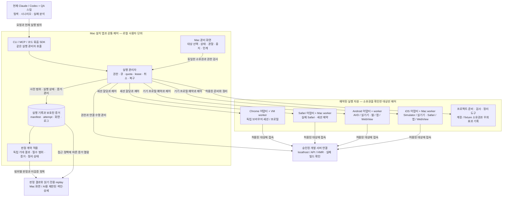
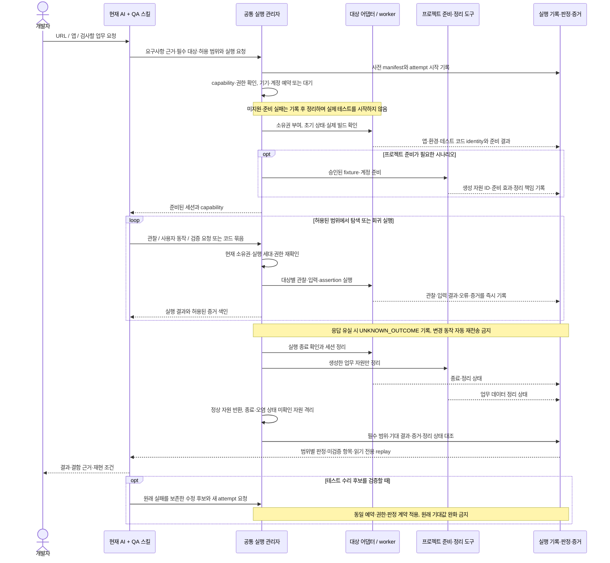

# app-qa — 기존 AI를 통한 격리 웹·모바일 병렬 QA - Epic

## Goal Capsule

현재 사용하는 Claude·Codex와 QA 스킬이 Ego Browser처럼 별도 실행 공간의 웹·앱을 관찰하고 조작한다. 로컬 개발 서버를 대상으로 독립 브라우저 세션과 여러 Android/iOS 기기 프로필을 병렬 실행하고, 시나리오별 판정과 증거를 남긴다. 개발자 자체 테스트에서 출발하되 반복 QA의 실행·결함 분석·재현·수정 후 검증을 대체하는 것까지 목표로 한다. 사용자가 작업 중인 브라우저·마우스·키보드를 임의로 점유하지 않는다.

이 문서는 지금까지의 대화에서 정리한 제품 요구사항·소스 조사·적대적 리뷰·설계·구현 작업·수용 기준을 app-qa에서 진행하기 위한 통합 에픽이다. 작업 및 이슈 관리 저장소는 [chonamdoo/app-qa](https://github.com/chonamdoo/app-qa)다. E2EVM은 VM 구현 참고 대상으로만 남으며 이 에픽의 개발·관리 위치가 아니다. 문서·이슈 게시와 제품 구현·플랫폼 검증·바이너리 공개를 구분한다.

**판독 기준:** D 항목은 사용자가 밝힌 요구·의향, 3절은 조사·관찰 근거, Q/AC와 작업 순서는 이를 충족하기 위한 설계·검증 계약이다. ‘권고’는 아직 확정하지 않은 구현 선택이다. 기능 구현, 보안 인증, 고객 제품 합격, QA 인력 대체 효과를 문서 작성으로 달성한 것으로 취급하지 않는다.

**2026-11-01 후속 사용자 결정:** AI에게 병렬 QA 실행 여부와 배치를 맡기는 역할을 폐지하고 일반 QA 담당자의 안정적·반복 가능한 제품 사용을 우선한다. 최신 설계 전달 기준은 [QAutra 제품 재설계 · Open Design 문서](2026-11-01-qautra-product-design-brief.md)다. 아래 D01/D11/D13·사용 흐름·Q01/Q15의 AI 중심 설명은 이전 결정 이력이며, 정식 회귀에서의 실행 중 AI 판단·수리 역할은 새 문서의 대체 범위를 따른다. 실제 대상·권한·소유권·증거·미확인 효과 보호와 다중 기기 지원 요구는 유지한다. 이 주석은 원격 에픽 갱신·제품 구현·현재 workflow 변경 승인이 아니다.

## 1. 사용자 결정과 범위

### 확정한 결정

- D01. 별도 AI 서비스를 필수로 붙이지 않는다. 현재 사용 중인 Claude·Codex가 판단하고, 새 프로그램은 환경 준비·관찰·입력·실행·증거 수집을 담당한다.
- D02. Ego Browser 수준의 사용 경험과 반응 성능을 목표로 웹과 앱을 조작한다. CLI/MCP 중 하나를 사용할 수 있는 AI 호스트에서 접근 가능해야 한다. 성능은 7절의 동일 조건 비교로 평가하며 Safari·native에 Ego의 단일 지연 수치를 일괄 적용하지 않는다.
- D03. 웹은 별도 VM의 브라우저 여러 개 또는 독립 브라우저 세션을 병렬 조작한다. 탭마다 VM 하나를 강제하지 않는다.
- D04. 모바일은 픽셀 크기만 바꾸는 방식이 아니라 서로 다른 기기 프로필의 독립 에뮬레이터·시뮬레이터를 사용한다. 작은 화면·일반 화면·큰 화면과 지원 대상 태블릿을 포함할 수 있다.
- D05. 여러 모바일 기기 프로필을 동시에 실행할 수 있어야 한다. 앞서 검토한 ‘모바일 전체 동시 1대 고정’은 최종 요구사항이 아니다. 동시 실행 수 1도 설정 가능한 값일 뿐이다.
- D06. 등록 프로필 수와 실제 동시 실행 수를 구분한다. 자원에 맞게 실행 상한을 설정하고 초과 작업은 대기시킨다. ‘수십 작업 등록’, ‘수십 페이지 실행’, ‘수십 모바일 OS 실행’은 다른 용량이다.
- D07. 데스크톱 Chrome·실제 Safari, Android Chrome·iOS Safari, Android/iOS 앱을 구분하여 테스트한다. 앱 내부 WebView는 별도 기능과 검증 경계를 둔다.
- D08. 당면 사용 사례는 localhost에서 실행하는 올리브영 외주 개발물의 QA다. 고객 코드·계정·화면은 공개 저장소나 외부 서비스에 자동 업로드하지 않는다.
- D09. 공개 프로젝트의 기능과 코드를 참고하되 독립적인 제품 구성을 설계한다. 재사용은 출처·라이선스·구체적 필요를 검토한 뒤 결정한다.
- D10. 사용자의 새 구현 배포 라이선스 의향은 Apache-2.0이다. app-qa의 권리 범위·배포 메타데이터와 재사용 코드의 고지 의무를 확인한 뒤 적용한다. 이번 기록 작업은 라이선스를 변경하지 않으며 참고 대상 E2EVM의 MIT 고지를 없애지 않는다.
- D11. 사용자가 설명한 현행 방식은 외주 개발자가 현재 AI에서 `web-qa` 스킬을 호출하고 Ego Browser로 자동화 테스트하는 것이다. 자연어 요청과 기존 스킬 중심의 사용 흐름을 유지한다. 별도 테스트 DSL·모델 서비스·CI 서버를 먼저 사용해야 하는 제품으로 바꾸지 않는다.
- D12. 사용자는 QA 업무를 대체할 수 있기를 원한다. 제품을 개발자 보조로만 제한하지 않는다. 다만 어떤 QA 업무·환경을 어느 수준으로 대체했는지는 결함 탐지와 사람 개입의 실측으로 구분하며, 모든 QA를 대체했다고 선포하지 않는다.
- D13. 제품은 Mac에 설치하는 관리 앱에서 격리된 테스트 환경과 결과를 다루고, 현재 Claude/Codex가 CLI/MCP로 제어하는 형태다. 웹과 Android/iOS 앱에 같은 사용 경험을 제공하되 모든 실행 대상을 하나의 VM에 넣지는 않는다. AI 자체를 guest에 설치하거나 관리 앱의 채팅 창으로 옮기는 것을 필수로 하지 않는다.

- D14. 2026-10-28 사용자 결정: 지금까지 논의한 전체 요구사항·설계·구조도·리뷰·작업 계획은 app-qa에서 진행하고 GitHub 에픽으로 관리한다. E2EVM에 추가했던 에픽과 상위 계획의 관련 항목은 제거했으며, E2EVM 자체 기능이나 기존 문서를 이 에픽 때문에 변경하지 않는다.

### 포함할 제품 범위

- 기존 AI의 지속 세션 기반 웹·앱 탐색과 명시적인 조작 도구.
- VM 및 모바일 실행 대상의 준비·할당·상태 조회·회수.
- 독립 브라우저·서로 다른 모바일 기기 프로필의 병렬 실행과 순차 순회.
- localhost 프런트엔드·API·HMR·인증 연결 확인.
- 요구사항·시나리오·환경·실행 시도·판정·증거의 연결.
- AI 탐색 후 재실행 가능한 회귀 시나리오로 남기는 경로.
- 실행 전에 계정·권한·데이터를 준비하는 프로젝트별 도구 연결.
- 실행 타임라인과 실패 당시 화면·도구 결과를 함께 읽는 replay, 기존 AI의 원인 분석과 근거 있는 테스트 유지보수.
- 현재 방식 대비 결함 탐지·동료 재현·수동 확인 부담을 비교하는 팀 도입 검증.

### 전제하지 않는 사항

- 모바일 실행기를 전부 일반 Linux/macOS VM 안에 중첩해서 넣지 않는다. 네이티브 호스트·별도 Mac·별도 Android 실행 머신도 같은 상위 인터페이스로 연결한다.
- 브라우저 WebKit 실행을 실제 Safari 검증으로, viewport 변경을 실제 모바일 OS 검증으로 대체하지 않는다.
- 한 AI 대화에 세션을 많이 연결한 것을 여러 독립 AI의 동시 판단으로 표현하지 않는다.
- 새 모델 API·클라우드 계정·유료 기기 팜·공개 터널·고객 코드 업로드를 기본으로 요구하지 않는다.
- 기존 E2EVM 내장 채팅의 텍스트를 자동 실행하는 것으로 이번 기능을 구현하지 않는다. 명시적인 agent tool 경로를 별도로 둔다.
- 등록 가능한 프로필 수를 실측 동시 처리량으로 홍보하지 않는다. 실기기·모든 OS 버전·모든 입력 조합의 전수 검증을 암시하지 않는다.
- 모든 실행마다 사람이 테스트 코드를 작성하거나 모든 AI 행동을 승인해야 한다고 전제하지 않는다. 승인된 범위와 기대 결과 안에서는 자율적으로 진행하고, 불명확한 업무 규칙·위험 동작·범위 변경만 확인한다.
- 화면 조작 성공, 자동 수정 후 PASS, 시나리오 수, 등록 기기 수를 QA 대체 효과의 증거로 쓰지 않는다.

### 사용 흐름과 책임 경계

1. 개발자가 지금처럼 현재 AI에 기획문서·기존 QA 시나리오와 개발 URL/앱·코드·테스트 범위를 함께 전달한다. 모든 입력이 필수인 것은 아니며 문서나 기존 시나리오가 없는 경우도 구분해서 진행한다.
2. AI와 스킬이 요구사항과 실제 화면을 대조한다. 기존 시나리오는 보존·보완하고, 없으면 작성하며 각 단계의 기대 결과와 출처를 정한다. 실행기는 대상·데이터·권한·연결의 준비 상태를 알려준다.
3. 현재 AI가 시나리오를 웹 제어용 JavaScript/TypeScript 또는 앱 제어용 스크립트로 만들어 실행 관리자에게 묶음 실행을 요청한다. 개별 동작마다 모델 판단을 강제하지 않는다. 새 상태를 조사하거나 추가 판단이 필요한 경우에는 관찰을 반환해 탐색을 이어간다. 제품은 격리·자원 할당·변경 동작의 소유권·관찰과 증거를 보장한다.
4. 실패하면 기존 AI가 필요한 replay 구간을 읽어 제품 결함·테스트 오류·환경 장애·판단 불가를 구분한다. 제품 코드 변경은 별도 허가 범위에서만 수행한다.
5. 반복할 가치가 있는 흐름은 기존 프로젝트 형식의 실행 가능한 테스트로 남긴다. 이후 동일한 기대 결과로 재실행하며 원래 실패와 수정 이력을 보존한다.

| 책임 | 담당과 경계 |
| --- | --- |
| 조사·시나리오·판정 설명 | 기존 Claude/Codex와 스킬. 별도의 필수 planner/judge를 새로 만들지 않는다. 코드가 현재 하는 일과 요구사항이 원하는 일을 구분한다. |
| 실행·격리·증거 | 새 제품의 공통 실행 핵심과 대상별 어댑터. 스킬의 지시만 믿고 소유권·권한·취소·증거 규칙을 생략하지 않는다. |
| 업무 준비·검증 기준 | 대상 프로젝트의 요구사항, 기존 테스트, 승인된 fixture/API와 계정 정책. 고객 고유 규칙을 범용 도구에 하드코딩하지 않는다. |
| QA 대체 범위 결정 | 검증할 업무·위험 등급·지원 환경에 대한 팀의 기준과 비교 결과. 자율 실행 권한과 대체 효과의 증명은 다르다. |

설치된 `web-qa` 스킬에는 이미 UI 조사·시나리오·batch 실행·판정 근거·증거·누락 대조 절차가 있다. 이를 두 번째 QA 시스템으로 다시 구현하지 않고 실행 API와 기록 형식을 연결한다. 스킬 이름이 같다는 것만으로 동일 정책을 보장하지 않으므로 실행에 사용한 스킬·설정의 버전 또는 digest를 남긴다. 웹용 스킬이 native 앱에도 수정 없이 적용된다고 가정하지 않는다.

결합 관계는 **`web-qa-skill`의 QA 절차 + `e2e`의 실행·테스트 코드화 기능 + app-qa의 관리·격리·판정 기록**이다. 이를 세 제품을 그대로 중첩 실행하거나 모든 대상을 하나의 엔진으로 처리한다는 뜻으로 쓰지 않는다.

- [chonamdoo/web-qa-skill](https://github.com/chonamdoo/web-qa-skill): 현재 AI가 기획문서·실제 UI를 조사하고 시나리오·기대 결과·실행 범위·증거를 연결하는 절차로 명시한다. 기존 스킬을 app-qa 내부의 새 planner로 복제하지 않는다.
- [tester-army/e2e](https://github.com/tester-army/e2e): MCP 관찰·조작, locator/assertion, 실행 가능한 테스트 초안과 회귀 실행 기능의 통합·재사용을 검증한다. 동작 기록이나 `test_lines`는 assertion이 완성된 업무 테스트와 같지 않다. 기존 AI가 작성한 스크립트를 실행하는 기본 경로에 두 번째 필수 LLM을 넣지 않는다.
- app-qa: 기존 Mac 앱·엔진·드라이버를 바탕으로 입력과 시나리오의 연결, 코드 묶음 실행, 자원·권한·기록을 관리한다. 실제 Safari·모바일 웹 등 e2e만으로 충족하지 못하는 대상은 해당 어댑터로 처리한다. 채택 버전·API와 라이선스, 같은 세션·증거 계약으로 연결할 수 있는지는 구현 전에 확인한다.

이번 요청의 실행 범위, 제품이 목표로 하는 지원 범위, 실제 검증된 지원 범위를 따로 관리한다. 사용자가 Chrome-only처럼 범위를 명시하면 해당 범위의 QA를 수행할 수 있지만 전체 제품 지원을 인증하지 않는다. 도구가 없거나 실패했다는 이유로 필수 대상을 사후 제외하지 않는다. 별도 범위 지시가 없다면 적용되는 스킬·제품 계약의 필수 대상을 따른다.

## 2. 용어와 실행 대상

| 용어 | 의미와 격리 경계 |
| --- | --- |
| 프로필 | 브라우저 또는 기기의 종류·OS/runtime·화면 특성·설정과 재사용 정책을 나타내는 구성. 현재 실행 중인 인스턴스와 다르다. |
| 인스턴스 | 실제로 실행 중인 VM·브라우저·에뮬레이터·시뮬레이터·연결된 실기기. 고유한 식별자가 필요하다. |
| 세션 | AI 작업이 특정 인스턴스와 상태를 사용하는 기간. 조작 권한·관찰 revision·수명주기를 묶는다. |
| worker | 할당된 호스트/게스트에서 실행하는 어댑터. 공통 의미를 제공하되 플랫폼별 사용자 경로·제약·미지원 기능을 숨기거나 성공으로 흉내 내지 않는다. |
| 브라우저 격리 | 쿠키·localStorage·프로필 등을 분리한다. OS·백엔드 계정·서버 데이터 격리까지 뜻하지 않는다. |
| OS 격리 | 별도 VM/모바일 OS 실행 환경. 동일 호스트 사용자 권한의 프로세스로부터 완전한 보안을 보장하지 않는다. |
| 기기 소유권 | 기기 한 대의 변경 동작을 한 시점에 한 작업만 수행하도록 배타적으로 할당한다. 서로 다른 기기는 병렬 실행 가능하다. |
| 실행 조합 | 시나리오 × 빌드 × OS/브라우저 × 기기/viewport × 방향 × 필요한 모바일 상태. |
| replay | 과거 실행의 화면·호출·결과·오류를 시간순으로 살펴보는 증거 묶음. 서버·기기 상태의 완전한 복원이나 변경 명령 재전송을 뜻하지 않는다. |
| oracle | 정상 여부를 판정할 기대 결과와 그 근거. 현재 화면이나 생성된 테스트 자체가 업무 정답의 유일한 출처가 되어서는 안 된다. |

| 대상 | 실행 경로와 증거 경계 |
| --- | --- |
| 데스크톱 Chrome | 실제 Chrome 실행 파일/channel과 버전을 확인한다. Linux VM에서의 Chrome 결과를 macOS/Windows Chrome 결과로 보고하지 않는다. |
| 빠른 웹 엔진 회귀 | 독립 브라우저 context/profile에서 Chromium·WebKit 등의 엔진을 확인한다. 실제 브랜드 브라우저와 별도로 표기한다. |
| 실제 데스크톱 Safari | macOS Safari + 검증된 WebDriver 경로. 전용 Mac/macOS VM 사용 여부와 권한·렌더링·포커스 제약을 실증한다. |
| Android Chrome | Android 에뮬레이터 또는 실기기의 Chrome. 키보드·브라우저 UI·시스템 뒤로가기를 포함한다. |
| iOS Safari | iOS Simulator 또는 준비된 실기기의 Safari. 시뮬레이터 결과와 실기기 결과를 구분한다. |
| Android/iOS 네이티브 앱 | 테스트 빌드 식별자·설치 경로·앱 식별자·플랫폼별 자동화 준비를 확인한다. 시뮬레이터 빌드를 실기기 빌드로 취급하지 않는다. |
| 하이브리드/WebView | 네이티브↔웹 context와 로그인·브리지·뒤로가기 전환을 명시한다. 접근성 트리에 일부 내용이 보인다는 이유만으로 DOM 자동화 지원을 선언하지 않는다. |

## 3. 현재 코드와 조사에서 확인한 사실

아래는 2026-10-27 조사에서 확인한 사실이며 2026-10-28에 app-qa 에픽으로 이전했다. 이전 시 확인한 소스 기준은 app-qa `86d5685651ede2bec57000c9b36e32d4ac5ea217`와 참고 저장소 E2EVM `e6a3df5ced1eae451c4a37bae394801843bda1f9`다. 외부 main 브랜치·설치 바이너리·제공 ZIP이 이 기준과 같은 revision이라고 가정하지 않으며, 재사용할 때 실제 버전·라이선스를 고정한다.

- E2EVM은 Rust 프로필/준비/전송과 Swift Virtualization.framework VM 소유권을 분리한다. [bridge](https://github.com/taejs/e2evm/blob/e6a3df5ced1eae451c4a37bae394801843bda1f9/src/bridge.rs), [native VM](https://github.com/taejs/e2evm/blob/e6a3df5ced1eae451c4a37bae394801843bda1f9/platform/macos/NativeMachine.swift), [guest transport](https://github.com/taejs/e2evm/blob/e6a3df5ced1eae451c4a37bae394801843bda1f9/src/guest.rs), [worker](https://github.com/taejs/e2evm/blob/e6a3df5ced1eae451c4a37bae394801843bda1f9/guest/worker.py)가 VM 참고 구현의 구성 요소다.
- E2EVM의 Python guest worker는 요청을 순차 실행한다. 여러 host `exec`를 동시에 호출하는 것만으로 같은 VM 안의 다중 작업 병렬 실행을 보장하지 않는다. 요청이 실행을 기다리는 동안 만료될 수도 있다. 기존 expiry를 제거하는 식으로 병렬화를 대체하지 않는다.
- E2EVM의 내장 assistant는 대화 조언용이다. 기존 에이전트가 외부 도구로 VM을 조작하는 경로와 구분한다. [assistant API](https://github.com/taejs/e2evm/blob/e6a3df5ced1eae451c4a37bae394801843bda1f9/src/assistant_api.rs), [assistant 실행](https://github.com/taejs/e2evm/blob/e6a3df5ced1eae451c4a37bae394801843bda1f9/src/assistant.rs).
- app-qa에는 실제 Chrome/Safari 및 Android/iOS 웹·앱 드라이버, batch QA·리포트가 있다. 당시에는 지속적인 직접 조작용 MCP가 없었고, 기본 target mutation에는 Jev commit 판단이 들어갈 수 있었다. 데스크톱은 공유 display 잠금으로 직렬화했다. 이후 B02 진행 상태는 아래 2026-10-31 후속 조사와 구분한다.
- app-qa의 기기 작업 큐는 서로 다른 기기 작업을 함께 시작할 수 있으나, VM/기기 생성과 용량 제어를 하는 시스템은 아니다. Appium/WDA 등의 worker별 포트·서비스 격리는 실제 구현 시 별도 확인한다.
- tester-army/e2e의 MCP 모드는 별도 모델 없이 기존 AI가 조작할 수 있다. 조사 시점 서버당 기본 4·최대 16 세션이다. 이는 해당 구현의 상한이지 새 제품의 확정 용량이 아니다.
- 조사한 e2e 웹 엔진의 WebKit은 실제 Safari가 아니다. 모바일 엔진은 `app.url`을 거부하며 설치된 앱을 대상으로 한다. 해당 엔진 하나로 네 가지 실제 웹 대상을 대체하지 않는다.
- 제공된 `moru-artemis-main.zip`의 `moru_mcp.py`는 Android host-driven adapter다. 별도 LLM 호출 없이 화면/요소·입력·wait·프레임·비교 도구를 제공한다. iOS/Safari 실행기나 업무 합격 판정기는 아니다.
- 재사용 주의점: 조사한 로컬 app-qa의 `src/runner/index.ts:334–339,374`는 웹 설정 해시를 `buildId`로 export한다. 이는 설정 identity이지 실제 제공된 프런트/API 빌드 identity가 아니다. `src/report/webqa.ts:60–68`의 required 목록은 종료 시 `summary.tests`에서 구성되므로 새 병렬 시스템의 사전 실행 계획을 대신하지 않는다.
- 종료 계약 주의점: app-qa `src/drivers/base.ts:205–210`은 `deleteSession()` 오류를 삼키며, `src/runner/index.ts:743–751`은 모바일 close 실패를 전파하지 않는 경로에서 잠금을 해제한다. 실제 고아 입력을 재현한 것은 아니지만, ‘종료 미확인 기기 재사용 금지’ 계약을 그대로 충족한다고 볼 수 없다. 이 경로는 조사 당시 로컬 app-qa 소스를 기준으로 확인했다. 위에 고정한 소스 revision과 이후 원격 HEAD를 구분한다.
- E2EVM `platform/macos/NativeMachine.swift:152–159`의 현재 VM 화면 캡처·입력은 보이는 view를 요구한다. 이 경로를 병렬 백그라운드 페이지 제어로 일반화하지 않는다. guest의 페이지 프로토콜 경로와 OS 데스크톱 입력 경로를 구분한다.

### 2026-10-27 app-qa 구조와 이 에픽의 전환 경계

초기 구현 계약은 [architecture Skill](https://github.com/chonamdoo/app-qa/blob/86d5685651ede2bec57000c9b36e32d4ac5ea217/skills/architecture/SKILL.md)과 [설계 문서](https://github.com/chonamdoo/app-qa/blob/86d5685651ede2bec57000c9b36e32d4ac5ea217/skills/architecture/references/design.md)에 있다. 이 에픽은 다음 구조를 설계하는 계획이며 기존 코드가 이미 아래 전환을 마쳤다는 뜻이 아니다.

- 기존 `mac/` SwiftUI 앱은 `qa serve`의 HTTP/SSE API를 사용한다. 기존 Mac 앱·CLI·엔진의 책임 경계를 출발점으로 삼으며 같은 자원을 따로 소유하는 두 번째 서버·runner를 만들지 않는다.
- 현행 LLM은 `qa plan`에서 읽기 전용 테스트 생성 역할이고 일부 대상 변경 동작에는 Jev commit 확인이 필수다. 새 방향은 현재 AI의 명시적 CLI/MCP 도구 사용이며 별도 모델 키를 기본으로 요구하지 않는다. 전환 시 모델 호출만 끄거나 전역 `allowRisky`를 켜는 대신 코드가 소유하는 실행 권한·위험 판단·관찰 신선도·판정 근거를 함께 설계하고 검증한다.
- 현행 데스크톱 display 잠금은 실제 포커스 충돌을 막는다. 격리 worker의 입력 경계·종료 확인이 증명되기 전에 잠금을 제거해 병렬화를 흉내 내지 않는다. native/WebView·실기기·다중 기기 프로필도 현재 지원 범위와 목표 지원 범위를 나눠 보고한다.
- 기존 테스트·driver·관찰·보고서 자산을 재사용하되 새 계약과 충돌하는 caller·테스트·문서는 실제 전환 작업에서 함께 갱신한다. 구 계약과 새 계약의 판정이 서로 다른 이중 경로를 영구 유지하지 않는다. 현재 아키텍처 Skill을 문서 이전만으로 바꾸지는 않는다.
- 이번 조사 중 `doctor` 결과와 과거 README/PR의 실행 기록을 구분한다. 기존의 플랫폼 통과 이력을 이 에픽의 VM 격리·기기 팜·QA 대체 효과 검증으로 재사용하지 않는다.

### Ego 공개 소스 추가 확인

- 공식 저장소는 [citrolabs/ego-lite](https://github.com/citrolabs/ego-lite)다. [CONTRIBUTING](https://github.com/citrolabs/ego-lite/blob/main/CONTRIBUTING.md)은 공개 범위를 JavaScript SDK와 agent Skill로 명시하고, browser application과 native bindings는 설치 앱이 별도로 제공한다고 설명한다. 저장소의 MIT를 브라우저 본체·native CLI 전체에 자동 적용하지 않는다.
- [Node helper README](https://github.com/citrolabs/ego-lite/tree/main/package/ego-browser), `src/index.ts`, `src/browser-runtime.ts`에서 확인한 경로는 기존 AI → `ego-browser nodejs` → 한 번의 JavaScript 실행에서 `TaskSpace`/`Page` API 호출 → native `globalThis.ego` → Chromium target/CDP다. 공개 helper의 이 실행 경로는 MCP를 전제로 하지 않는다. native CLI host의 구현이 공개 `run.ts`와 같다고 가정하지 않는다.
- 의미 기반 snapshot은 native `ego.snapshot`에 위임한다. 공개 driver에는 CDP `Input.dispatchMouseEvent`와 `Page.captureScreenshot` 경로가 있다. 요소/ref 기반 조작과 스크린샷을 본 좌표 mouse/keyboard 조작을 함께 제공한다. 이는 브라우저 viewport 제어의 근거이며 OS 데스크톱 전체를 제어한다는 증거는 아니다.
- [저장 상태 문서](https://github.com/citrolabs/ego-lite/blob/main/skills/ego-browser/references/clearing-state.md)는 같은 browser profile의 Space가 쿠키·HTTP cache를 사용자 탭 및 다른 Space와 공유한다고 명시한다. Space의 작업/탭 소유권 분리와 테스트 계정·저장 상태 격리를 혼동하지 않는다.
- 설치된 `ego-browser 0.6.1.13`에서 임시 localhost 버튼을 snapshot ref로 클릭하고 canvas를 화면에서 관찰한 좌표로 클릭했다. 두 경로 모두 실제 페이지의 완료 카운터가 증가하고 `click` 이벤트의 `isTrusted`가 true였다. 이는 해당 입력과 결과의 실행 증거이며 native 구현 전체·OS 전역 입력·VM 격리의 증거가 아니다. 소유한 Space와 임시 서버는 종료했다. 공개 main 소스가 설치 바이너리와 동일 revision이라고 단정하지 않는다.
- 공개 driver의 V2 `Page.click`은 요소 해석·명중 검사를 거치고, `Page.mouse.click`은 viewport 좌표로 CDP 입력을 전송한다. 표시되는 agent cursor 애니메이션은 별도 시각화 hook이며 시스템 포인터 이동의 증거가 아니다. 일부 legacy helper에는 synthetic DOM event fallback이 있으므로 모든 Ego API 성공을 trusted input으로 일반화하지 않는다. 새 QA의 기본 경로에서는 이 fallback으로 원래 사용자 입력 실패를 숨기지 않는다. 근거: [page-actions](https://github.com/citrolabs/ego-lite/blob/main/package/ego-browser/src/driver/page-actions.ts), [pointer](https://github.com/citrolabs/ego-lite/blob/main/package/ego-browser/src/driver/pointer.ts), [page-model](https://github.com/citrolabs/ego-lite/blob/main/package/ego-browser/src/page-model.ts).

### 관찰한 실행 증거와 한계

- app-qa의 실제 `qa doctor`로 Node·Appium 드라이버·OCR·ADB·Xcode·Chrome·Safari 설치 상태를 확인했다. 모바일 대상은 부팅되지 않아 건너뛰었고 Safari 자동화 세션도 열지 않았다. 진단 성공을 네 환경 E2E 통과로 기록하면 안 된다.
- 현재 조사 호스트는 Apple M5 Pro, CPU 18코어, 메모리 48 GiB였다. 동시 브라우저/모바일 OS 처리량 벤치마크는 수행하지 않았다.
- 기존 Ego CLI로 임시 localhost 페이지 두 개를 함께 열고 각 버튼을 조작하여 서로 다른 완료 상태를 확인했다. 화면을 확인한 뒤 소유한 페이지와 임시 서버를 종료했다. VM·쿠키 격리, 수십 세션 성능, Safari·모바일의 증거는 아니다.
- 올리브영 대상 개발 소스·실행 URL·승인된 계정·업무 기대 결과는 이번 조사에서 제공/확인되지 않았다. 실제 고객 제품 QA 결과는 없다.

### 토스 영상에서 확인한 접근과 적용 한계

자료는 [토스 FE 개발자들의 검증법](https://www.youtube.com/watch?v=YCNcTpcDRf8&t=802s)이다. Ego Browser로 지정 구간 전후와 관련 슬라이드·시연·화면 자막을 확인했다. 전체 음성을 전사한 것이 아니며 토스 내부 도구의 소스·라이선스·일반적인 성공률을 검증한 것도 아니다.

| 확인 구간 | 확인한 내용 | 제품에 적용할 설계 판단 |
| --- | --- | --- |
| [07:00–09:00](https://www.youtube.com/watch?v=YCNcTpcDRf8&t=420s) | 환경 재현·AI 활용, 실무자 기반 접근, 테스트용 상품·인증·미션 등 API 마련 | 브라우저 조작뿐 아니라 승인된 업무 시작 상태를 준비할 수 있어야 한다. 테스트 준비용 API가 검증할 사용자 단계를 대신하면 안 된다. |
| [11:00–12:00](https://www.youtube.com/watch?v=YCNcTpcDRf8&t=660s) | 에이전트의 기기 도구 사용과 확인한 흐름을 E2E 코드로 남기는 설명 | 기존 AI·스킬 사용 방식에서 반복 실행 가능한 테스트를 남긴다. 사용자가 먼저 테스트 코드를 작성하도록 강제하지 않는다. |
| [13:00–13:38](https://www.youtube.com/watch?v=YCNcTpcDRf8&t=780s) | AI가 깨진 E2E를 수리한다는 목표, `nova replay`의 호출·화면·오류, 버튼 문구 변경을 찾지 못한 사례 | 실패 당시 관찰과 실행 코드를 연결한다. 반복 재시도 횟수를 늘리는 것으로 원인 분석을 대신하지 않는다. |
| [14:10–14:40](https://www.youtube.com/watch?v=YCNcTpcDRf8&t=850s) | 실패 영상·로그·API 호출 JSONL을 에이전트에 제공하고 분석·수정하는 흐름 | 사람과 AI가 같은 증거를 열람한다. 원래 실패·수정 근거·diff·별도 재실행을 보존한다. |
| [15:40](https://www.youtube.com/watch?v=YCNcTpcDRf8&t=940s) | 로그 기반 시나리오, 기기 제어, replay를 AI에 제공하는 정리 | 새 필수 모델보다 현재 AI가 사용할 실행·진단 도구를 우선한다. |

영상은 QA 전체 대체, 자동 수정의 무오류, 상태의 완전한 되감기, Safari/VM 대규모 병렬 처리의 증거가 아니다. 영상에 등장한 내부 API·도구명을 공개 API나 재사용 가능한 오픈소스로 간주하지 않는다.

### 2026-10-31 후속 조사와 최종 반영

[최종 연구·적대적 리뷰 보고서](../research/2026-10-31-qa-deep-research.md)에 고정 source revision, ZIP SHA256, 실행 방법·수치·한계, 후보별 영향·장단점과 독립 리뷰 2건의 반영 결과를 기록했다. 앞선 조사 기록은 당시 기준으로 보존한다.

- 설치된 Ego `0.6.2.5` / Chromium `156.0.8078.74` / usage guide `v2.2.0`을 확인하고 자체 합성 페이지에서 warm helper 호출을 측정했다. 실제 고객 앱·app-qa 대비 성능·Safari/native·cold start·병렬 처리량은 검증하지 않았다. 이 측정값은 제품 SLA나 전 플랫폼 동등 성능의 증거가 아니다.
- 진행 중 `feat/qautra-b02` 소스에는 session API, JS/TS worker, CLI/MCP/SDK와 직접 실행의 권한·revision·증거 경계가 있다. 제품 소유 합성 fixture 범위의 구현이며 여섯 대상·일반 고객 프로젝트 지원 완료를 뜻하지 않는다. 구형 main의 MCP 부재를 현재 B02의 부재로 옮겨 주장하지 않는다.
- 새 planner·필수 모델·DSL·별도 실행 관리자를 추가하지 않는다. 기존 B02/B08/B09 사용자 흐름에 측정을 병행하고, Q02의 관찰 범위·판정 계약을 명확히 한다. 후보별 identity RPC bulk화·screenshot 분리·stable ref 재설계는 필요성과 순편익 확인 전 채택하지 않는다.
- 기존 D/Q/B/R 및 전체 지원 범위·완료 조건을 유지한다. 이번 문서 반영은 새 작업 단위 추가, 구현 완료, 실제 고객 QA 통과 또는 GitHub 이슈 본문 갱신을 의미하지 않는다.

## 4. 요구사항과 수용 기준

아래 AC는 향후 구현 완료를 판단할 설계·검증 계약이며 현재 통과한 항목이 아니다. Q14–Q16은 최신 사용 방식·QA 대체 목표·영상과 적대적 리뷰를 반영한 추가 제안이다. 별도 승인 서버나 새 테스트 언어의 도입을 뜻하지 않는다.

### Q01. 기존 Claude·Codex 연결

- CLI와 MCP는 같은 실행/권한/세션 핵심을 사용한다. 기존 AI 호스트의 일반 인증을 유지하고 자격 증명을 복사하지 않는다.
- CLI/MCP라는 연결 형식과 의미 기반/시각 기반 조작 방식을 분리한다. Ego처럼 여러 동작·조건 분기·결과 대기·다음 관찰을 한 번에 실행하는 코드 실행/SDK 경로를 설계에 포함한다. 개별 동작마다 AI tool 왕복을 강제하지 않는다. MCP는 같은 세션 실행 핵심을 노출하는 연결 수단이며 Ego의 실제 하부 구현이라고 설명하지 않는다.
- 코드 묶음에도 실행 시간·취소·허용된 세션·기기 소유권·증거 규칙을 적용한다. 코드 실행 편의성을 이유로 권한 검사를 건너뛰지 않는다.
- 새 프로그램의 기본 조작 경로는 추가 모델 호출을 요구하지 않는다. 선택적인 모델 기반 planner/judge는 사용자가 명시적으로 선택하는 별도 기능으로 둔다.
- 기본 실행 단위는 현재 AI가 시나리오에서 작성한 코드 묶음이다. 웹은 브라우저 제어용 JavaScript/TypeScript, 앱은 기기 드라이버를 호출하는 스크립트를 사용하며 정확한 앱 실행 언어·SDK는 채택 명세에서 정한다. 기획과 시나리오 작성, 코드 생성의 주체는 현재 AI이고 app-qa가 별도 모델로 같은 작업을 다시 수행하지 않는다.
- 묶음 안에서 관찰·입력·조건 분기·readiness 대기·assertion·증거 수집을 실행한다. 웹 제어 코드를 실행한다는 것은 강제 DOM 변경으로 성공을 만드는 것이 아니며, 앱 제어는 모든 네이티브 앱에 JavaScript를 주입한다는 뜻이 아니다. 지원되지 않거나 추가 판단이 필요한 상태는 근거와 함께 반환하고 AI가 다음 묶음을 결정한다.
- **AC:** 현재 AI가 새 모델 API 키 없이 세션 생성→관찰→입력→결과 확인→종료를 수행한다. 존재하는 세션에 다시 연결해 계속 작업할 수 있다. 내장 chat 응답 문자열은 실행되지 않는다.
- **AC:** 한 호출에서 이미 관찰한 대상을 여러 번 조작하고 기대 상태를 기다린 뒤 다음 관찰을 반환한다. 중간 결과가 다음 판단을 바꾸는 경우에는 관찰을 끼워 넣을 수 있다. 실패 후 나머지 변경 동작을 무조건 실행하거나 전체 코드 묶음을 자동 재시도하지 않는다.
- **AC:** 현재 AI와 스킬의 자연어 요청에서 실제 대상 조작·판정 근거·증거까지 연결된다. 프로젝트가 이미 제공하는 시나리오·runner·report를 재사용한다. 기존 스킬에 없는 native/WebView 기능은 지원 범위와 필요한 확장을 명시한다.
- **AC:** 웹의 다단계 시나리오와 앱의 다단계 시나리오를 각각 AI가 작성한 스크립트의 한 실행 요청으로 수행한다. 각 입력마다 모델 호출 없이 대기·검증·증거 기록이 진행되고, 결과를 시나리오 단계에 연결한다. 중간 실패·취소·결과 미확인을 주입하면 이후 변경 동작을 무조건 계속하거나 묶음 전체를 재전송하지 않는다.

### Q02. 공통 세션과 지원 기능 선언

- 대상별 `open/observe/screenshot/act/wait/status/close` 의미를 통일하되 정확한 공개 명칭은 구현 설계에서 정한다. 이 이름은 현재 제공 CLI 명령이 아니다.
- 결과는 run/job/session/worker/instance/request 식별자, target 종류·실제 버전, 관찰 revision, 시각과 오류 원인을 포함한다. 원시 자격 증명은 제외한다.
- 변경 동작은 명시 세션과 최신 관찰에 연결한다. 지원하지 않는 DOM·입력·센서·녹화 기능은 capabilities와 오류로 드러낸다.
- 의미 기반 요소/접근성 관찰과 시각 기반 screenshot·좌표·키보드 입력을 함께 다룬다. canvas 등 의미 정보가 부족한 표면도 관찰 후 조작할 수 있도록 한다. 웹의 DOM/ref 경로, 브라우저 viewport 좌표 입력, 모바일 기기 입력, OS 전역 computer-use를 별도 capability로 표시한다.
- 관찰의 viewport/frame/페이지 범위와 해당 assertion에 필요한 관찰 수단을 구분한다. 화면 안의 iframe·canvas·닫힌 shadow·제외된 콘텐츠도 semantic 미검출만으로 시각적 부재를 입증하지 못한다. screenshot 파일의 존재와 기대 결과의 실제 검증도 구분한다. 필요한 표면·oracle을 확인할 수 없으면 해당 assertion만 판단 불가로 남기고 무관한 assertion까지 일괄 차단하지 않는다. 기존 CAP/depth 초과 관찰의 absence·대상 기반 mutation 거부는 유지한다.
- 좌표에는 관찰 대상·화면 revision·CSS/device pixel·DPR·frame/viewport 변환을 연결한다. 오래된 화면이나 다른 기기의 좌표를 재사용하지 않는다. 가려진/비활성 요소를 DOM 강제 클릭으로 우회하여 원래 사용자 경로를 통과했다고 처리하지 않는다.
- **AC:** 여러 세션에서 생략/잘못된 대상 지정이 다른 세션으로 넘어가지 않는다. 오래된 요소 참조와 미지원 동작을 거부한다. CLI/MCP에서 같은 원인과 결과를 관찰한다.
- **AC:** 의미 기반 버튼 조작과 의미 정보가 부족한 canvas의 화면 좌표 조작을 각각 실행하여 실제 결과를 확인한다. 입력 이벤트 생성 성공만으로 업무 판정을 대신하지 않는다. host-global 입력을 사용하지 않는다고 주장할 경우 포커스·포인터·클립보드 변화를 별도로 측정한다.
- 관찰 revision만으로 화면이 변하지 않았다고 가정하지 않는다. 입력 직전에 대상 identity·가림·활성 상태와 소유권을 재검사하고, 페이지의 자발적 변경·회전·인계 뒤 낡은 요소/좌표를 사용하지 않는다.

### Q03. VM 안의 다중 웹 작업

- 여러 독립 브라우저 인스턴스/context/profile을 준비하고 병렬 작업에 할당한다. 같은 CDP 브라우저의 탭만 나눈 경로는 공유 상태를 명시한다.
- 페이지마다 VM 하나를 강제하지 않는다. 같은 VM 안의 브라우저 격리와 서로 다른 VM의 OS 격리를 사용 목적에 맞게 선택한다.
- guest 명령 워커의 직렬 병목을 우회한다고 장기 명령을 무제한 실행하지 않는다. 지속 세션 실행부의 동시 작업·취소·출력·회수 정책을 설계한다.
- **AC:** 서로 다른 세션에 별도 로그인/저장 상태를 넣고 한쪽의 변경이 다른 쪽에 섞이지 않음을 확인한다. 두 작업의 실제 실행 구간이 겹치고 각 결과가 올바른 세션으로 돌아온다. 한 worker 실패가 다른 결과를 성공으로 바꾸지 않는다.
- **AC:** 에이전트용 페이지 캡처·입력은 호스트의 선택된 VM 창과 독립적으로 동작한다. OS 수준 대화상자·IME를 다루는 작업은 해당 guest 데스크톱 사용권을 배타적으로 확보하며 다른 페이지 입력과 혼합하지 않는다.

### Q04. 모바일 프로필과 여러 독립 인스턴스

- 기기 모델·플랫폼·OS/runtime·화면 크기/밀도·방향·앱/브라우저 버전·테스트 설정을 기록한다. 제조사 하드웨어 재현 여부도 구분한다.
- 서로 다른 Android AVD와 iOS Simulator 프로필을 등록·생성/재사용·부팅·정지·선택할 수 있어야 한다. 실제 연결 기기는 운영자가 선택한 대상으로만 다룬다.
- **AC:** 다른 기기 프로필 두 개를 동시에 띄워 고유 기기 식별자로 조작하고 상태·화면·결과가 섞이지 않음을 확인한다. Android와 iOS 각각 검증하고 두 플랫폼의 동시 실행도 검증한다. 하나의 runtime/device 이름만 바꿔 여러 기기로 보고하지 않는다.
- 프로필의 초기 상태, 도구 소유 디렉터리, 앱·브라우저·runtime·worker/driver 버전을 고정 또는 검증한다. 재사용 상태를 의도한 시나리오만 warm 상태를 허용한다. 전용 AVD/device set을 우선하며 개인 기기의 초기화·전체 데이터 삭제를 자동 실행하지 않는다.
- **AC:** 이전 작업의 로그인·설정·파일 표식이 다음 독립 작업에 남지 않거나, 의도한 공유 상태로 명시된다. host/worker 호환성 불일치는 실행 전에 발견되고 다른 환경 버전의 결과는 구분된다.

### Q05. 자원 상한과 대기열

- 등록 프로필 수, 부팅 인스턴스 수, 실행 세션 수, AI 판단 작업 수를 구분한다. 웹·Android·iOS 및 전체 상한을 설정 가능하게 한다.
- CPU·메모리·디스크·서비스 포트와 부팅 부하를 고려한다. 충돌 없는 작업을 실행하고 나머지는 원인과 함께 대기시킨다. 자동 중첩 가상화 지원은 가정하지 않는다.
- **AC:** 모바일 상한 1에서 다른 프로필 작업이 대기하고 자원 반환 후 시작한다. 상한을 늘리면 별도 프로필이 병렬 실행된다. 시작/종료 중인 인스턴스도 자원 계산에 포함하며 자원 부족은 제품 실패와 분리한다.
- **AC:** 대기 취소와 실행 취소를 구분한다. 재연결·worker 종료·부팅 실패에서 무제한 추가 실행이나 자원 누수가 없고 대기 작업이 영구 정체되지 않는다.
- 설정 가능한 quota와 플랫폼·드라이버의 실제 상한을 구분한다. Safari 세션 수, 부팅 부하, 공유 Appium/ADB/CoreSimulator 등 장애 범위를 어댑터 검증 초기에 확인한다. 상한을 초과한 요청은 원인이 있는 대기/거부이며 제품 assertion 실패가 아니다.
- **AC:** 여러 자원을 함께 요구하는 작업이 부분 소유권을 무한히 붙잡지 않는다. 기기·계정·포트 등 충돌 키를 일관된 순서/원자적 예약으로 확보하고, 취소·관리자 재시작 뒤 대기열이 복구된다.

### Q06. 기기 소유권과 안전한 수명주기

- 한 기기에 변경 동작을 수행하는 작업은 한 시점에 하나다. 프로세스/세션의 소유권과 만료·비정상 종료 회수 조건을 정의한다.
- 기기별 Appium/system/WDA/mjpeg 포트와 필요한 빌드/임시 경로를 분리한다. 다른 작업의 드라이버·포트·계정·앱 상태를 회수하지 않는다.
- **AC:** 같은 기기를 동시에 요청하면 하나만 획득하고 나머지는 대기/충돌 오류를 받는다. 서로 다른 기기는 동작 가능하다. 취소·crash 후 소유 자원만 정리되고, 확인되지 않은 기기는 다음 작업에 재사용되지 않는다.
- 상태를 소유하는 실행 관리자는 CLI/MCP 연결 수와 무관하게 하나의 기기에 단일 변경 권한을 부여한다. 연결 종료와 작업 취소를 구분하며 재연결·idle 만료 정책을 명시한다.
- 소유권 세대 번호를 변경 명령의 dispatch 직전에 검사한다. 이미 드라이버에 전달한 명령은 세대 번호만으로 취소되지 않는다. 반환 확인 전에는 회수 중으로 두고, 종료·초기 상태가 불확실하면 격리하여 재할당하지 않는다.
- **AC:** MCP 두 개와 CLI가 같은 기기를 경합해도 소유자는 하나다. 관리자 crash 후 진행 중 요청의 불확실성이 보존되고 복구 확인 전 기기가 재사용되지 않는다. 취소 직전·전송 직후의 지연 입력, 드라이버 종료 실패, 공유 서비스 장애를 각각 주입하여 다른 작업의 상태가 오염되지 않음을 확인한다.

### Q07. Chrome·Safari·모바일 웹·네이티브·WebView

- 대상별 드라이버와 지원 표를 갖춘다. actual Chrome/Safari, 엔진 회귀, 모바일 브라우저, native, WebView를 별도 결과로 남긴다.
- iOS 실기기는 신뢰·Developer Mode·서명·XCTest/WDA 등 필요한 준비를 검사한다. 앱 설치나 기기 설정 변경은 명시된 테스트 범위와 허용된 대상에서만 수행한다.
- **AC:** 실제 Chrome/Safari와 Android Chrome/iOS Safari에서 같은 승인 시나리오를 각각 실행한다. Android/iOS 앱은 각각 테스트 빌드로 검증한다. WebView 전환은 웹·네이티브 양쪽의 결과로 확인하고 불가하면 BLOCKED로 남긴다.
- **AC:** 도구나 기기가 없다고 다른 엔진으로 대체하여 해당 대상 PASS를 만들지 않는다. simulator/emulator 결과를 physical-device 결과로 표시하지 않는다.
- 같은 업무 시나리오는 기대 결과·fixture·결과 ID를 공유하되 실행 경로는 target별로 달라도 된다. hover·시스템 뒤로가기·브라우저 뒤로가기·native/WebView 전환을 하나의 동일 스크립트로 강제하지 않는다. 필요한 단계 미지원은 우회 PASS가 아니다.

### Q08. localhost·API·HMR·인증 연결

- host localhost와 VM/실기기 localhost를 구분한다. 개발 서버를 한 번 준비하고 필요한 worker에만 사설 연결/프록시/포트 전달을 구성한다.
- 프런트·별도 API·WebSocket/HMR·OAuth redirect·cookie origin·HTTPS 인증서를 함께 고려한다. host HTTP 성공만으로 장치 연결을 판정하지 않는다.
- ADB reverse/터널/서버 bind는 기존 설정과 충돌을 검사하고 작업이 만든 연결만 해제한다. 기본으로 공개 터널을 만들거나 방화벽/TLS를 끄지 않는다.
- **AC:** 각 대상의 실제 브라우저/앱에서 승인된 개발 빌드·리소스·API·인증·필요한 HMR이 동작한다. 종료 후 원래 포트 전달은 보존된다. worker별 포트가 겹치는 실패를 숨기지 않는다.
- 탐색용 live/HMR 실행과 판정용 고정 빌드 실행을 구분한다. 검증 실행은 실제 제공된 프런트·API·앱 바이너리·관련 설정/feature flag의 identity를 기록하고 필요한 경계에서 확인한다. Git SHA나 URL/프로필 해시만으로 동일 빌드를 증명하지 않는다.
- **AC:** 실행 중 코드 변경·한 대상의 stale cache·서로 다른 API 빌드를 주입하면 혼합 결과가 동일 빌드의 전체 PASS가 되지 않는다. HMR 자체를 검사할 때는 허용한 변경 전후 identity와 확인 결과를 별도로 남긴다.

### Q09. 화면 크기·방향·모바일 상태 검사

- 제품 지원 범위에 맞는 작은/일반/큰 휴대폰과 필요한 태블릿 프로필을 선택한다. OS와 기기 조합의 근거를 남긴다.
- 코드에서 확인한 반응형 경계 전후는 빠른 웹 viewport 회귀로 검사하고 실제 모바일 OS 검사와 따로 기록한다.
- 키보드·한글 IME·글자 크기·safe area·홈 인디케이터·주소창 확장/축소·회전·모달/하단 고정 버튼을 시나리오 적용 조건으로 둔다. 실제 OS 측정값과 CSS viewport를 구분한다.
- **AC:** 해당 상태가 실제 재현된 전체 기기 화면을 남기고 정상 터치·스크롤로 주요 기능에 도달하여 결과를 확인한다. 가로/세로 전환 시 요구된 상태가 유지된다. 키보드를 표시하지 않고 키보드 가림 검사를 PASS 처리하지 않는다.
- 전체 조합의 무조건적인 곱 대신 납품 지원 범위·반응형 경계·업무 위험에 따라 필수/선택 조합을 정한다. 실행 전 manifest에 고정하고, 변경 관련 subset 결과를 전체 호환성 인증으로 확대하지 않는다. 기기 프로필이 특정 제조사 하드웨어나 실기기 특성을 완전히 재현한다고 주장하지 않는다.

### Q10. 탐색·회귀·기대 결과

- 현재 AI의 탐색 모드와 재현 가능한 batch 회귀를 구분한다. 탐색으로 발견한 요소/상태를 시나리오와 연결한다.
- 기대 결과의 출처를 요구사항/승인된 계약/표준/관찰/추론으로 구분한다. LLM의 동작 완료 주장·픽셀 차이·버튼 클릭 성공만으로 업무 PASS를 결정하지 않는다.
- 계정·권한·서버 fixture·세션·정리 범위를 시나리오별로 고정한다. 동작 캐시 재연이나 self-healing이 실패 단계를 건너뛰거나 다른 사용자 경로로 바꿔 PASS를 만들지 않게 한다. 여기서 동작 재실행과 Q15의 읽기 전용 replay는 다른 기능이다.
- **AC:** 명시적인 자동 검증이 가능한 업무 조건은 근거가 고정된 기대 결과를 assertion과 필요한 화면/재조회 증거로 확인한다. critical 시나리오의 negative control은 정상 PASS→의도한 결함 도달 확인→해당 업무 assertion FAIL→복구 후 PASS를 보여야 한다. setup/selector timeout 같은 무관한 실패로 탐지 능력을 입증하지 않는다.
- 명시적인 검증이 가능한 업무 조건은 assertion으로 확인하고, 시각적·탐색적 판단은 실제 관찰·기준·불확실성을 함께 남긴다. 모든 탐색을 미리 작성된 스크립트로 제한하지 않으며, 관찰/추론만으로 업무 요구사항 준수 PASS를 만들지 않는다.
- oracle과 시나리오의 출처·revision·변경 사유를 기존 프로젝트 형식에 연결한다. 관련 요구사항이 바뀌면 필요한 재검토를 표시한다. 기존 승인 정책 안의 실행마다 사람의 재승인을 요구하지 않는다.

#### 입력 조합과 기존 시나리오 보존

- 한 작업에 기획문서/요구사항, 기존 QA 시나리오, 개발 URL 또는 설치 가능한 앱·필요한 코드 정보를 함께 연결한다. 입력은 프로젝트가 이미 사용하는 문서·테스트 형식을 우선하며 새 DSL이나 새 문서 저장 서버를 필수로 만들지 않는다. 문서의 위치·절/항목·revision과 현재 적용 범위를 기록한다.
- 기존 시나리오가 있으면 ID·원본 단계·기대 결과·출처를 유지하고, 실제 UI·기획과의 차이 및 추가/수정 후보를 구분한다. AI가 새로 생성한 시나리오로 기존 필수 항목을 덮어쓰거나 삭제하지 않는다. 기존 시나리오가 없으면 요구사항과 실제 UI에서 작성하되 확인된 기대 결과와 추론을 구분한다.
- 기획문서만 있고 실행 대상이 없으면 시나리오 초안만 작성하고 실제 UI 조사·E2E는 미실행으로 남긴다. 반대로 URL/앱만 있으면 관찰 가능한 시나리오를 진행하고 알 수 없는 업무 규칙만 분리한다. 부족한 입력 때문에 독립적으로 가능한 검증까지 중단하지 않는다.
- 명확한 현행 기획과 실제 동작이 다르면 제품 결함으로 보고한다. 기획·기존 시나리오의 적용 시점이나 우선순위가 불명확하면 요구사항 충돌로 기록하고 해당 기대값을 확정하지 않는다. 구현에 맞춰 기획·기대 결과를 자동 변경하지 않는다.
- **AC:** 같은 기능을 ‘기획문서+기존 시나리오+실행 대상’과 ‘기획문서+실행 대상’으로 각각 입력한다. 전자는 원본 시나리오와 보완 내역을 보존하고 후자는 출처가 있는 시나리오를 작성한다. 대상이 없는 문서 입력에는 실행 결과를 만들지 않으며, 필수 단계 누락이나 기획·구현 불일치를 통과로 숨기지 않는다.

#### 요구사항부터 증거까지의 추적

- `기획서 항목·revision → 시나리오 ID·revision → 실행 스크립트·hash → 대상 환경·빌드·attempt → 판정·증거`를 기존 프로젝트 형식에 연결한다. 하나의 스크립트가 여러 시나리오를 실행해도 단계·assertion·증거가 어느 요구사항에 해당하는지 식별할 수 있어야 한다.
- 기획문서가 바뀌면 연결된 시나리오·스크립트·이전 결과를 영향 검토 대상으로 표시한다. 영향 관계를 알 수 없으면 미확인으로 남긴다. 이전 revision에서의 결과는 보존하되 새 요구사항의 PASS로 재사용하지 않으며, 변경된 기대값의 근거를 확정한 뒤 새 attempt로 재검증한다.
- **AC:** 요구사항 하나를 변경하면 연결된 시나리오·스크립트·결과를 찾아 재검토/재실행 대상으로 표시한다. 무관한 항목을 근거 없이 변경하지 않는다. 이전 실패·증거·revision을 유지하며 새 결과에서 원래 기획서 항목까지 역추적할 수 있다.

### Q11. 진행 화면·증거·리포트

- Mac 설치 앱의 관리 화면은 실행/대기/실패/정리 중인 대상과 실제 상태를 표시한다. 선택한 브라우저/기기를 관찰하고 필요하면 사용자가 조작을 인계받을 수 있다. 여러 화면을 항상 전면에 띄울 필요는 없다. GUI와 CLI/MCP는 같은 실행 관리자를 사용한다.
- run/build/scenario/target/attempt별 원래 오류·종료 코드·기대/실제 결과·스크린샷·가능한 trace/video/log를 분리 보관한다. 증거 저장과 사용자에게 실제 전달했는지를 구분한다.
- 상태는 PASS/FAIL/FLAKY/BLOCKED/NOT_RUN/SKIPPED로 구분한다. 필수 조합의 누락·증거 부족·필수 정리 실패가 전체 PASS에 가려지지 않게 한다.
- **AC:** 한 기기의 실패와 다른 기기의 통과를 별도로 추적하고 전체 필수 조합과 대조할 수 있다. 종료/다음 실행이 이전 실패 증거를 지우지 않는다. 사용자의 현재 작업 포커스·포인터·클립보드 변화 여부를 실제 측정한다.
- 실행 전 required manifest와 모든 attempt를 대조한다. 종료 후 생성한 결과 목록을 필수 범위의 유일한 출처로 쓰지 않는다. 0개 실행·필수 shard 누락·중단·필수 skip은 해당 범위의 전체 PASS를 막는다.
- 업무 판정, 실행 원인/확실성, 증거·정리 상태를 별도로 보존한다. UNKNOWN_OUTCOME은 해당 변경과 자원에 연결한다. 서로 다른 빌드·fixture의 결과를 FLAKY로 묶지 않으며, 업무 deadline 위반과 도구 자체 timeout을 구분한다.
- 사람에게 인계할 때 AI의 변경 동작을 중지한다. 복귀 시 기존 ref를 무효화하고 재관찰한다. 사람의 개입은 기록하며, 자동화하지 않은 개입 단계를 무인 회귀로 보고하지 않는다. Safari처럼 인계로 세션이 끊기는 경우 새 세션/attempt 경계를 표시한다.
- **AC:** 원래 제품 FAIL 뒤 cleanup 실패가 발생해도 두 원인이 남는다. 필수 결과 누락·0개 테스트·인계 후 낡은 입력을 각각 검출한다. 원시 runner 종료 코드와 최종 QA 판정은 구분하여 CLI/MCP/report에서 같은 사실을 전달한다.
- **AC:** 다른 개발자의 지원 Mac에 앱을 설치·실행하고, 기존 AI의 CLI/MCP 요청과 관리 화면이 같은 실행·자원 상태와 결과를 보여 주는지 확인한다. 앱에서 인계·중지를 요청해도 별도 제어자가 생기지 않는다. 설치 전제와 배포 방식은 명시하며 현재 소스 빌드만으로 배포 준비 완료를 주장하지 않는다.

### Q12. 권한·개인정보·불확실한 실행 결과

- localhost 접속은 임의 결제·발송·삭제·게시를 허가하지 않는다. 승인된 테스트 계정·합성 데이터와 명시적인 위험 동작 정책을 사용한다.
- 비밀값·고객 코드·쿠키·개인 화면을 인자/로그/공개 artifact에 남기지 않는다. 화면을 현재 AI에 보내는 것도 데이터 전송이므로 고객사 승인 범위를 확인한다.
- CDP/ADB/MCP/worker 제어 포트를 외부에 무인증 공개하지 않는다. 도구 결과와 페이지 내 지시는 실행 권한을 확장하지 못한다.
- **AC:** 다른 세션·허용되지 않은 파일/기기/대상에 접근하는 요청을 거부한다. 현재 사용자 소유 탭·기기·VM은 자동 채택/종료하지 않는다. 응답 유실 후 변경 동작을 자동 재전송하지 않고 UNKNOWN_OUTCOME을 드러낸다.
- 코드 묶음은 상태를 소유하는 관리자와 분리하여 실행하고 deadline·출력 한도·취소를 관리자 쪽에서 강제한다. 같은 사용자 권한의 프로세스 분리는 악성 코드에 대한 보안 sandbox가 아니다. 임의 host shell/파일/네트워크 접근을 허용하면서 세션 API만으로 강한 격리를 보장한다고 주장하지 않는다.
- 허용된 테스트 코드와 협조적 클라이언트의 오조작 방지, 페이지/로그의 비신뢰 콘텐츠, 비신뢰 코드의 OS 수준 격리를 구분한다. 코드 실행 위치·권한·파일 mount·네트워크와 보호할 자산을 구현 전에 명시한다. 고객 화면을 기존 AI에 전송하는 경우도 승인 범위에 포함한다.
- **AC:** 코드 묶음의 무한 루프·초과 출력·관리자 연결 종료가 다른 작업을 멈추거나 권한을 확장하지 않는다. 페이지/로그의 지시로 범위·비밀정보 전송·판정 기준이 바뀌지 않는다. 필수 증거의 안전한 수집이 불가능하면 수집을 강행하거나 PASS 처리하지 않는다.

### Q13. Apache-2.0 공개와 출처 관리

- 새 구현의 배포 목표는 Apache-2.0이다. 작업 저장소는 app-qa로 확정했다. 공개 제품명·배포 단위·기여자 권리 범위를 확인한 뒤 해당 LICENSE와 패키지 메타데이터를 맞춘다. 이번 문서 추가는 기존 저장소 재라이선스가 아니다.
- MIT/Apache-2.0 코드를 재사용할 때 원본 저작권·라이선스를 유지하고, 해당 Apache 배포물의 NOTICE가 요구되면 보존한다. 변경 표시 등 적용 의무를 검토한다. 사용자가 소유한 코드도 포함된 타사 코드의 권리까지 자동 소유하는 것은 아니다.
- FSL·AGPL 등 다른 조건의 코드/바이너리/모델/이미지는 Apache-2.0이라고 일괄 표시하지 않는다. 라이선스 검토 없이 기본 배포 의존성으로 넣지 않는다. 코드 복제·번역·재작성만으로 원본 의무가 사라진다고 가정하지 않는다.
- **AC:** 재사용 항목마다 출처 URL·고정 revision/version·라이선스·복사한 범위·변경 내용·배포 방식과 고지 경로를 확인할 수 있다. 신규 LICENSE/metadata/third-party notices가 일치하고 고객사 자산·자격 증명·Apple OS 이미지가 포함되지 않는다.

### Q14. 프로젝트별 테스트 준비와 업무 데이터 격리

- 기존 fixture·계정·테스트 API를 프로젝트가 제공하는 준비/검사/정리 도구로 연결한다. 범용 제품은 실행 계약을 제공하고 고객 업무 규칙·인증 우회·운영 데이터 생성 기능을 내장하지 않는다.
- hook의 허용 환경·입력·생성 자원 ID·변경 효과·충돌 키·정리 책임을 명시한다. 기기뿐 아니라 계정/tenant/공유 데이터도 경쟁을 조정한다. 일부만 준비된 실패와 결과 미확인 상태를 보존한다.
- 준비 hook이 설정한 상태와 UI로 검증한 단계를 구분한다. 로그인 자체를 검사하면서 로그인 hook으로 해당 단계를 대체하거나, 저장을 검사하면서 API로 저장 결과를 먼저 만들어 두지 않는다.
- **AC:** 독립 fixture는 병렬 실행되고 공유 충돌 키는 대기한다. 한 실행의 정리가 다른 실행의 데이터를 삭제하지 않는다. 준비·정리·응답 유실 뒤 오염 가능 자원은 확인 없이 정상 풀로 돌아가지 않는다.
- **AC:** 테스트용 hook이 검증 대상 단계를 대신한 경우 해당 UI 검증을 PASS로 보고하지 않는다. 승인되지 않은 백엔드·계정·외부 부수 효과를 실행 전에 거부한다.
- mock/stub 백엔드, 권한 사전 부여, launch argument, 저장 상태 주입도 준비/우회 효과로 기록한다. 실제 dev/staging·mock·혼합 중 어느 백엔드인지, hook이 활성화된 빌드인지와 어떤 단계에 영향을 주는지 attempt에 연결한다.
- **AC:** 로그인 hook을 쓴 실행은 로그인 UI 검증을, 권한 사전 부여 실행은 권한 대화상자 검증을 충족하지 못한다. mock 결과는 실제 서버 저장 검증이 아니다. 해당 경로가 필요한 scope에서는 우회 없는 시나리오의 누락이 전체 PASS를 막는다. UI+mock 검사 자체의 제한된 결과는 별도로 보고할 수 있다.

### Q15. replay·테스트 생성·근거 있는 자동 유지보수

- 기록은 실행 시작부터 수집한다. run/attempt/target/step/action과 순서를 기준으로 관찰·입력 요청·dispatch/응답·오류·화면/영상·관련 로그를 연결한다. 서로 다른 worker의 벽시계만으로 순서를 단정하지 않는다.
- replay 열람은 읽기 전용이며 저장된 변경 명령을 실행하지 않는다. 실행 상태를 다시 만들거나 재검증하는 것은 초기 상태·권한을 확인한 새 attempt다.
- 기존 AI가 읽을 수 있도록 compact index와 필요한 구간 조회를 제공한다. 전체 영상·DOM·로그를 매 호출마다 모델에 밀어 넣지 않는다. 원본 증거의 보존과 AI에 전달한 범위를 구분하고, 필터링·누락·수집 상한을 표시한다.
- 비밀값·PII를 화면·trace·HAR·로그별로 다룬다. 수집/전송 허용 범위와 보존 기간·용량·삭제 정책을 정하며, 로그 문자열 redaction이 영상·스크린샷까지 안전하게 만든다고 가정하지 않는다.
- 탐색 기록에서 기존 테스트 형식의 재실행 가능한 시나리오를 생성할 수 있게 한다. 임시 ref·좌표·토큰을 영구 locator·기대값으로 복사하지 않는다. 생성물은 실제 실행 전까지 미검증이다.
- 현재 AI가 시나리오에서 만든 웹·앱 제어 스크립트도 위 실행 기록에 연결한다. 탐색 동작을 옮긴 초안에는 시나리오의 기대 결과·assertion·초기 상태·정리·필수 대상이 빠지지 않았는지 확인한다. 코드 생성, 스크립트 실행 완료, 업무 조건 통과를 서로 다른 상태로 기록한다.
- 자동 수정은 원래 oracle·범위·필수 사용자 경로를 유지하는 근거 있는 locator/wait 등 테스트 오류 교정으로 제한한다. 승인된 정책에 포함되면 행동마다 사람 확인을 요구하지 않는다. 제품 코드·업무 기대값·필수 범위·baseline을 바꾸려면 해당 변경 권한과 근거가 별도로 필요하다.
- **AC:** 필요한 화면·도구 결과·빌드/초기 상태 기록으로 두 번째 개발자와 기존 AI가 같은 실패 지점을 찾거나 재현 불가 원인을 식별한다. 필요한 증거 누락·타임라인 불일치·전송 불가는 명시되고 전체 PASS에 숨지 않는다.
- **AC:** 의도 근거가 있는 locator 교정과 잘못된 문구/기능 변경을 구분한다. 원래 실패·근거·diff·수정 후 attempt를 모두 남기고, assertion 삭제·skip·경로 우회·기대값 완화로 얻은 성공은 정상 판정에 반영하지 않는다. 수정 횟수/시간 상한이 도달하면 원래 실패와 미완료 항목을 보존한다.
- 수정 AI의 ‘정답을 유지했다’는 설명만으로 자동 반영하지 않는다. 실행 시점 테스트 코드와 helper/설정의 관련 revision·hash, 어댑터가 수집할 수 있는 실제 assertion·대상·경로, 변경 의도의 독립 근거를 확인한다. 가시 문구 locator는 요구사항 검증 역할을 겸할 수 있으며, 소스가 바뀌었다는 사실만으로 그 변경이 올바르다고 인정하지 않는다.
- 자동 반영 정책은 검증 가능한 수정 종류를 허용 목록으로 정한다. 알려진 동일 대상·정답·경로를 유지하는 교정은 자율 처리할 수 있다. 동일성을 확인할 수 없는 문구·이미지·helper 변경은 후보로 실행할 수 있지만 검토 전 정상 판정에 반영하지 않는다. assertion 수나 파일 diff만으로 의미의 동등성을 증명하지 않는다.
- 원래 판정 기준은 수리 대상과 분리한다. scope/기대값·baseline·timeout/retry 정책 변경을 locator 교정으로 위장하지 않는다. 지원하는 runner의 실행 사실과 기록을 대조하고, 필요한 추적 능력이 없는 어댑터에서는 자동 반영을 허용하지 않는다. 개발자의 임의 저장소 편집을 물리적으로 금지한다는 뜻이 아니라, 근거 없는 성공을 제품의 결과 판정에서 불인정한다는 뜻이다.
- 실행 기록은 제품 실행부가 남기며 AI가 작성한 요약과 구분한다. 파일 해시는 무결성 확인 수단이지 사실성이나 같은 OS 사용자에 대한 변조 방지의 증명이 아니다. 공유 환경에서 증거 조작 방지를 약속하려면 별도의 권한 경계가 필요하다.
- 재현·수리 후보도 일반 실행과 같은 lease·quota·quarantine을 따른다. attempt에는 목적, 실제 테스트 코드·스킬·앱/환경·백엔드/fixture identity, 소유권 세대를 연결한다. 원래 실패와 `repair_of` 관계를 남기고, 실행 중 테스트 변경·환경 변경으로 비교 불가한 결과를 FLAKY나 수리 성공으로 묶지 않는다.
- 재현 결과는 ‘동일 조건에서 재현’, ‘동일 조건에서 미재현’, ‘조건 차이로 비교 불가’로 구분한다. 재현 요청은 저장된 동작의 재전송 명령이 아니다. UNKNOWN_OUTCOME이 남은 자원에서 확인 없이 같은 부작용을 다시 만들지 않는다.
- target별 증거 수집 능력과 공백을 기록한다. 판정에 필수인 증거와 선택적 진단 자료를 구분하고, 후자의 단독 수집 실패를 제품 결함으로 바꾸지 않는다. 대용량 영상·trace는 guest 명령 응답에 억지로 넣지 않고 소유권·용량·무결성을 확인하는 artifact 전달 경로를 사용한다.
- **AC:** 잘못된 문구 배포, helper 내부 assertion 약화, 실행 중 테스트 파일 변경, 한 플랫폼에서만 검증된 수리를 각각 주입한다. 원래 실패를 지우거나 다른 플랫폼/정답의 PASS로 확장하지 않는다. critical 수리본은 원래 negative control도 여전히 해당 업무 assertion으로 실패해야 한다.
- **AC:** 합성 토큰·개인정보 표식을 화면/로그에 넣고 허용된 모델 출력에 노출되지 않는지 확인한다. 요약 상한·수집 공백·증거별 전송 제한을 표시하며, 필수 증거를 안전하게 제공할 수 없는 결과는 통과로 숨기지 않는다.

### Q16. 팀 사용성과 QA 대체 효과 검증

- QA 대체는 업무·기능·환경 단위로 정의한다. 반복 실행·환경별 확인·결함 보고·수정 후 재검증을 자동화하되, 클릭 수나 자동 생성 테스트 수를 대체율로 쓰지 않는다.
- 테스트 대상 코드·현재 UI를 읽고 시나리오를 만드는 능력과, 구현에서 빠진 요구사항을 발견하는 능력을 따로 검증한다. 승인된 요구사항·과거 결함·격리된 결함 주입 등 실행 대상과 독립된 기준을 사용한다.
- 팀의 기존 방식과 같은 빌드·범위·조건으로 비교한다. 결함 탐지/누락, 잘못된 결함 보고, 잘못된 PASS, 위험한 자동 수정, 사람 개입과 분석 시간, 준비·실행·유지 비용을 분모와 함께 기록한다.
- **AC:** 최초 AI 대화·개인 로그인 상태가 없는 두 번째 개발자가 기존 자연어/스킬 흐름으로 준비·실행·결함 재현을 수행한다. 새 모델 키·새 테스트 DSL을 필수로 요구하지 않으며 미지원 대상은 사전 진단에 나타난다.
- **AC:** 자동 수정이 실제 결함을 숨기는 경우와 누락된 기능이 시나리오에서도 빠지는 경우를 평가한다. 평가용 기대값은 수리 대상이 아니며 원래/수정 후 검출 능력을 비교한다. 실제 QA 대체 범위·남은 사람 검토·미검증 범위를 함께 보고한다.
- **AC — 회사 업무 흐름:** 최초 대화에 참여하지 않은 팀원이 승인된 기획문서와 개발 대상, 기존 시나리오가 있으면 함께 제공한다. 현재 AI와 `web-qa-skill`의 절차로 원본 시나리오 보완 또는 신규 작성 → 웹·앱 제어 스크립트 생성 → 요청 범위의 실제 환경에서 묶음 실행 → 요구사항별 결함·증거 보고 → 수정된 제품의 새 attempt 재검증까지 수행한다. 기존 AI 외의 필수 모델 키나 팀원의 수동 코드 재작성을 전제로 하지 않는다.
- **AC — 기획과 구현의 충돌:** 승인된 기획에 있으나 UI에서 누락된 기능과 기획과 다르게 동작하는 기능을 포함해 평가한다. 요구사항의 적용이 명확하면 결함으로, 문서 간 기대값이 미정이면 충돌/판단 불가로 남긴다. 현재 UI를 정답으로 복제하거나 기존 필수 시나리오를 제외해 PASS를 만들지 않는다.
- 평가 결함은 심각도별로 집계하고 같은 결함의 기기별 중복 발견을 탐지 수로 부풀리지 않는다. 도구가 만든 테스트에만 맞춘 결함 주입 외에 독립적으로 판정한 과거 결함·누락 요구사항을 포함한다. 준비·오탐 처리·검토·유지보수를 포함한 총 사람 시간을 비교한다. 유한한 평가에서의 미탐 0건은 미래 모든 결함의 무누락 보증이 아니다.
- 미탐은 시나리오 누락·잘못된 oracle·대상 미실행·준비 우회·환경 불안정·자동 수정으로 은폐 등 원인별로 분류한다. 비교 기간과 되돌린 자동 수정도 기록한다. 생성/수리 엔진에 평가 정답을 제공한 결과와 독립 평가 결과를 혼합하지 않는다.
- 제품이 요구하지 않는 CI 서버·공유 기기 팜·대시보드부터 만들지 않는다. 기존 runner/CI가 있으면 동일 실행 기록과 판정 계약으로 연결하며, 대화형 탐색에서 얻은 가치를 먼저 검증한다.
- 기존 CI가 있다면 추가 모델 없이 회귀 실행·증거 수집을 완결하고 기존 개발자 AI가 실패 묶음을 분석하는 경로를 우선한다. 무인 AI 수리는 별도로 허용된 agent 실행 환경·인증·비용 정책이 있을 때만 선택한다. 구독 자격 증명을 추출하거나 새 모델 키를 기본 요건으로 만들지 않는다.

## 5. 참고 소스와 재사용 판단

이 표는 기능 조사와 재사용 후보를 기록한 것이며 채택·복사·설치 승인이 아니다. 일반적인 기능 아이디어 참고와 실제 코드/자산/배포물 재사용을 구분한다.

| 참고 소스 | 참고할 구현/기능 | 확인한 제약과 라이선스 처리 |
| --- | --- | --- |
| [app-qa](https://github.com/chonamdoo/app-qa) | 실제 Safari/모바일 웹 드라이버, 요구사항 추적, batch 결과, 기기 소유권·정리 | 2026-10-31 조사한 B02에는 직접 session·CLI/MCP/SDK 경로가 구현 중이다. 합성 fixture 권한·capability와 전체 지원 완료를 구분하며 기본 Jev 호출·display 직렬화를 단순 제거하지 않는다. 코드별 타사 고지와 배포 라이선스는 재사용 시 확인한다. |
| [web-qa-skill](https://github.com/chonamdoo/web-qa-skill) | 기획 근거·실제 UI 조사, 시나리오 작성, 코드 묶음/기존 runner 실행 절차, 요구사항·환경·증거 대조 | 단독 runner나 driver 설치 도구가 아니다. 웹 절차의 native 적용 범위를 구분하고 실제 스킬 revision/digest를 기록한다. 코드·파일 재배포 시 라이선스와 출처를 별도 확인한다. |
| [Ego 공개 SDK/Skill](https://github.com/citrolabs/ego-lite/tree/main/package/ego-browser) | 코드 묶음 실행, TaskSpace/Page, semantic snapshot/ref + screenshot/좌표 입력, native/CDP 경계 | 공개 저장소는 MIT. [별도 브라우저/native bindings](https://github.com/citrolabs/ego-lite/blob/main/CONTRIBUTING.md)까지 MIT 공개라고 주장하지 않는다. 같은 profile의 Space는 쿠키/cache를 공유하며, 공개 SDK를 다른 Chromium에서 그대로 실행할 수 있다고 가정하지 않는다. |
| [agent-browser](https://github.com/vercel-labs/agent-browser) | CLI inspect-act-verify, 독립 session, browser/CDP 연결 | Apache-2.0. 동일 CDP 브라우저의 tab pinning은 쿠키/OS 격리가 아니다. |
| [agent-device](https://github.com/callstack/agent-device) | CLI/MCP/API, 기기 식별·소유권, 접근성·입력·증거 | MIT. 플랫폼별 capabilities와 실기기 준비 조건을 확인한다. |
| [tester-army/e2e](https://github.com/tester-army/e2e) | 공통 engine, [MCP 세션](https://github.com/tester-army/e2e/blob/main/docs/reference/mcp.mdx), locator, assertion, 동작 캐시 재연(해당 프로젝트의 replay), 보고서 | Apache-2.0 패키지. [모바일 engine](https://github.com/tester-army/e2e/blob/main/packages/mobile/src/engine.ts)은 모바일 웹 경로를 제공하지 않으며 실제 Safari도 별도다. 해당 replay와 이 문서의 읽기 전용 증거 replay를 구분한다. |
| [Playwright MCP](https://github.com/microsoft/playwright-mcp) / [Playwright](https://github.com/microsoft/playwright) | isolated context, profile 분리, CDP, 명시 assertion·trace | Apache-2.0. WebKit과 실제 Safari, 모바일 emulation과 OS 기기를 구분한다. |
| [mobile-mcp](https://github.com/mobile-next/mobile-mcp) | 기존 AI가 iOS/Android를 관찰·조작하는 tool 계약 | Apache-2.0. 로컬 실행과 선택적 클라우드 기능을 구분하며 기기 팜을 자동 구축해 주는 것으로 보지 않는다. |
| 사용자 제공 moru-artemis ZIP / [fork](https://github.com/taehwandev/moru-artemis) | `moru_mcp.py`, `moru_elements.py`, `moru_comparison.py`, `moru_perf.py` | 제공 ZIP 문서상 Apache-2.0과 upstream/Minitap NOTICE 유지. ZIP이 원격 HEAD와 같다고 가정하지 않는다. Android-only이며 별도 모델 호출 없음. 비교 결과는 제품 PASS가 아니다. |
| [Cua](https://github.com/trycua/cua#licensing) | Lume VM 관리, SDK/CLI, desktop UX와 도구 경계 | MIT 구성과 Spaces/cua-spacesd 등의 FSL-1.1-MIT 구성을 구분한다. 저장소 전체가 MIT가 아니다. |
| [Tart](https://github.com/openai/tart) / [UTM](https://github.com/utmapp/UTM) | VM 프로필·이미지·수명주기·자동화 방식 | 기능/설계 참고 후보. 재사용 시 각 실제 구성의 라이선스부터 확인한다. permissive 라이선스라고 일괄 분류하지 않는다. |
| [Lightpanda](https://github.com/lightpanda-io/browser/blob/main/LICENSING.md) | 선택적 의미/텍스트 중심 headless 검사 방식 | 조사 시 upstream 기본 AGPL-3.0-only. e2e adapter의 Apache 라이선스와 다르다. 실제 Chrome/Safari 레이아웃·화면 호환성 검사 대체재로 채택하지 않는다. |

### 공식 플랫폼 근거

- [Android Emulator 하드웨어 가속과 중첩 VM 제약](https://developer.android.com/studio/run/emulator-acceleration).
- [Apple nested virtualization 지원 확인 API](https://developer.apple.com/documentation/virtualization/vzgenericplatformconfiguration/isnestedvirtualizationsupported). 지원 여부를 대상 호스트/runtime에서 검사하며 M5라는 이름만으로 판정하지 않는다.
- [Tart FAQ](https://tart.run/faq/): nested 범위와 guest→host 연결 참고. 문서의 특정 칩 지원 설명을 현재 호스트 실증으로 사용하지 않는다.
- [Appium XCUITest capabilities](https://appium.github.io/appium-xcuitest-driver/latest/reference/capabilities/), [Android Emulator 네트워크](https://developer.android.com/studio/run/emulator-networking-address): 실제 도입 버전과 일치하는 설정을 선택한다.
- [Apple Safari WebDriver](https://developer.apple.com/documentation/webkit/about-webdriver-for-safari): Apple이 설명하는 macOS windowing 환경에서는 활성 Safari 인스턴스 하나와 부착 WebDriver 세션 하나로 제한된다. 같은 환경의 인스턴스 증설이나 quota 상향으로 병렬성을 가정하지 않는다. 사람이 automation glass를 깨서 세션을 중단하면 기존 연결이 영구적으로 끊어지며 복귀는 새 세션 경계를 따른다.

### 권고하는 최소 구조와 재사용 우선순위

다음은 채택 전 실증할 설계 제안이다. 모든 후보 라이브러리를 한 제품에 넣지 않으며 실제로 채택할 엔진은 초기 실행 증거로 정한다. 현재 AI의 web-qa 절차와 진행 중 B02를 출발점으로 유지한다. e2e의 공개 `run()`/`openHost()` 연결은 기존 suite·fixture 재사용 등 구체적 편익이 있을 때 평가하며 핵심 전체 도입을 선행 조건으로 두지 않는다. Moru는 분리 관찰·로컬 대기 등의 패턴만 참고하고 별도 Python 서버나 자율 multi-agent를 기본 구성으로 추가하지 않는다.

#### 구성 요소와 실행 경계

구현 목표 구조다. Mac에 설치하는 앱이 관리 화면과 실행 관리자에 대한 진입점을 제공한다. 현재 AI는 host에서 CLI/MCP를 호출하고, 실제 테스트는 예약된 VM·Mac worker·기기에서 수행한다. 상자는 책임 경계이며 별도 서버·프로세스의 개수를 뜻하지 않는다. 플랫폼별 어댑터와 worker를 한 상자에 묶었으며, 실제 배치는 대상과 격리 요구에 맞춘다.

- 여러 기기 프로필은 병렬로 예약할 수 있지만 하나의 기기는 동시에 한 제어자만 가진다. 계정·fixture 충돌과 플랫폼 제한도 함께 적용한다(Q05–Q06, Q14).
- 개발 서버 연결은 UI 입력을 우회하는 경로가 아니다. 네이티브 앱은 해당 앱이 사용하는 승인된 API에 연결하며, 모든 대상에 HMR이 필요한 것은 아니다(Q07–Q08).
- 화살표는 제어·관리 책임과 대상 연결을 나타낸다. worker의 관찰·증거 반환과 AI의 반복 요청은 아래 실행 순서도에 분리했다. 페이지와 로그는 비신뢰 입력이며 AI에 돌아갔다고 권한·기대값 변경의 근거가 되지 않는다(Q10–Q12).
- Safari·iOS의 Mac worker는 승인된 별도 macOS 실행 환경이나 전용 Mac 등 실제 지원 가능한 배치를 검증해 선택한다. Android/iOS를 Linux VM 안에 모두 중첩 실행한다는 뜻이 아니며, 공유 worker의 사용자 권한 경계는 별도 설계한다.
- 판정은 별도 AI나 새 테스트 언어를 뜻하지 않는다. 기존 스킬·runner의 역할을 유지하면서 실행 결과를 사전 범위와 대조한다. 탐색적 관찰과 명시적 업무 PASS를 구분한다(Q10–Q11).

#### 테스트 요청부터 결과 확인까지

여러 대상에 예약된 독립 실행이 각각 아래 흐름을 따른다. 코드 묶음 안에서 여러 관찰·입력을 실행할 수 있으므로 모든 단계마다 모델 호출이 필요한 것은 아니다.

실패·취소도 기록과 정리를 거친다. replay 열람 자체는 worker에 입력을 보내지 않으며 재현·수리 검증은 새 attempt다. 필수 증거 부족이나 정리 미확인은 성공으로 숨기지 않는다(Q11–Q12, Q15).

- 실행 관리자는 로컬 사용자 단위 단일 소유자와 영속 기록을 우선 검토한다. CLI/MCP마다 독립 큐를 만들지 않는다. SQLite 같은 로컬 저장소로 세션·자원 예약·attempt·manifest를 관리하는 것으로 시작할 수 있으며 분산 DB를 기본 요구하지 않는다.
- 코드 묶음은 별도 프로세스에서 실행하고 관리자가 권한·시간·취소를 강제한다. browser/device 프로토콜 자격 증명을 임의 코드에 직접 노출하면서 API 소유권만으로 통제된다고 주장하지 않는다. 악성 코드 격리와 로컬 사용자의 실수 방지는 Q12에서 구분한다.
- Chrome은 진행 중 app-qa 경로를 출발점으로 삼고, 부족한 기능이나 재사용 편익이 확인되면 Playwright/CDP 기반 기존 엔진을 비교한다. 실제 Safari·모바일 웹·native도 app-qa/Appium 경로를 먼저 평가하고, 목적에 부족한 경우 agent-device 등 대안을 비교한다. 기본 Jev 호출을 분리할 때 전역 `allowRisky`로 안전 정책을 없애지 않는다.
- VM 수명주기는 외부 참고 구현인 E2EVM의 재사용 또는 연결을 검토하되, 보이는 host view나 직렬 mailbox를 그대로 고동시성 에이전트 실행기로 취급하지 않는다. guest 브라우저 세션 실행 경로를 분리한다.
- 어댑터는 capability·오류·취소·증거 계약을 공유하되 플랫폼별 코드를 같은 스크립트로 강제하지 않는다. 테스트 준비·회귀·보고서는 기존 자산을 재사용하고 새 범용 DSL·QA planner·승인 서버를 만들지 않는다.
- 환경 manifest와 host/worker 호환성 검사를 제공한다. 드라이버/브라우저/OS 업그레이드는 대표 계약 시나리오로 먼저 확인하고, 이전 검증 환경을 복구할 수 있는 정책을 둔다. 실패 시 다른 엔진으로 몰래 대체하지 않는다.
- 팀원이 각자 자기 환경을 쓰는 것과 여러 사용자가 같은 기기 서버를 쓰는 것은 다른 배포 모델이다. 공유 호스트를 선택하면 사용자 인증·자원 권한·증거 접근·GUI 세션 소유권을 추가 설계한다. 기본으로 공개 제어 서버를 열거나 개인 기기를 채택하지 않는다.
- 대시보드는 상태 목록·실패 시점 열람·명시적 인계를 먼저 제공한다. 항상 켜진 다중 화면 스트리밍, 새로운 기기 팜, 모바일 중첩 VM을 기본 전제로 하지 않는다. 원격 실행과 다수 프로필 요구를 삭제하는 것은 아니다.

## 6. 구현 작업 단위와 의존 관계

작업 저장소는 app-qa다. 기존 TypeScript QA 엔진과 SwiftUI Mac 앱을 출발점으로 삼고, VM 경로에 필요한 E2EVM/Rust·Swift 코드의 재사용 또는 어댑터 연결 방식은 B01–B04에서 검증해 정한다. 외부 패키지는 아직 최종 채택하지 않았으며 별도 저장소로 제품을 옮기는 계획이 아니다. 작업 순서는 선행 의존성을 뜻하며 기능 축소나 별도 납기 약속이 아니다. 공통 추상화와 대규모 자원 관리부터 완성하지 않고, B02에서 서로 다른 대상의 제약을 확인하면서 B07–B09의 작은 실제 흐름을 함께 연결한다. 고객 입력이 없을 때의 합성 fixture 검증과 고객 QA 완료는 구분한다.

| 작업 | 내용 / 요구사항 | 선행 작업 | 완료 증거 |
| --- | --- | --- | --- |
| B01 | 제품/권한 경계·Apache-2.0 공개 단위·외부 재사용 명세 / Q12–Q13, Q16 | 없음 | app-qa 권리 범위와 외부 MIT 고지 보존, 출처/버전/배포 의무, 로컬·공유 호스트와 허용 고객 데이터 범위 |
| B02 | 현재 스킬과 최소 session 핵심·CLI/MCP/SDK, AI 작성 스크립트 묶음 실행과 이질적 대상 실증 / Q01–Q02, Q07, Q12 | B01 | 현재 AI가 웹·앱 제어 스크립트를 작성해 한 요청으로 실행, e2e 연결 가능 범위 확인, 새 필수 모델 없음, Safari/기기 제약을 공통 API 고정 전에 확인 |
| B03 | 지속 소유권·대기열·자원 상한·취소/복구 / Q05–Q06, Q14 | B02의 최소 실행 계약 | 여러 클라이언트 경합, 기기·계정 충돌 키, 세대 검사, 종료 미확인 격리, crash 복구 |
| B04 | VM 브라우저 다중 세션·guest 지속 실행 / Q03, Q12 | B02–B03 | host view와 독립된 캡처/입력, 저장 상태 격리, 실제 병렬 구간, 불확실한 변경 결과 보존 |
| B05 | Android/iOS 프로필·환경 기준 상태 / Q04, Q06 | B02–B03 | 플랫폼별 두 프로필 및 혼합 실행, 포트/서비스 분리, 초기 상태·worker 버전 확인 |
| B06 | 실제 브라우저·native·WebView의 필수 지원 확대 / Q07 | B02의 초기 실증; 해당 B04/B05 실행 경로 | 각 필수 환경의 실제 사용자 경로·결과·인계 제약. 미준비는 명시하되 전체 완료로 처리하지 않음 |
| B07 | localhost·API·인증·HMR·프로젝트 준비 도구 / Q08, Q14 | B02부터 시작; 이후 해당 B04–B06 대상 연결 | 대상 안의 실제 빌드 확인, hook의 준비/검증 경계, 데이터 격리·정리, owned route 회수 |
| B08 | 문서·기존 시나리오 입력, 요구사항→스크립트→증거 추적, 매트릭스·탐색→회귀·판정 / Q09–Q10, Q15–Q16 | B02부터 B07/B09와 병행; 전체 범위는 B06 이후 | 원본 시나리오 보존·보완, 문서 revision 변경 영향 식별, 사전 범위·업무 negative control, 두 번째 팀원의 회사 업무 흐름 재현 |
| B09 | Mac 관리 앱·실행 기록·replay·인계·안전한 테스트 유지보수 / Q11–Q12, Q15 | 최초 변경 동작부터 B02와 연결; B03의 소유권/취소와 통합 | 지원 Mac 설치·기존 AI와 동일 실행 상태, 필수 누락 대조, 읽기 전용 replay, 보호된 증거·한도, 원래 실패와 수정 diff·새 attempt 보존 |
| B10 | 전체 통합·팀 비교 평가·용량·공개 준비 / Q01–Q16 | B01–B09 | 아래 DoD와 수용 기준, 실측 QA 대체 범위·유효 상한·미지원 조건·라이선스 |

### 일정 추정의 전제

대화에서 작업량과 일정도 질문했으나 이 에픽은 검증되지 않은 납기·동시 실행 수·QA 대체율을 확정하지 않는다. B02의 실제 업무 흐름과 Safari/모바일 제약 실증 뒤 기존 app-qa 재사용량, 필요한 worker·배포 작업, 팀 인수 기준을 바탕으로 B01–B10의 작업량을 산정한다. 작은 첫 실증은 전체 지원 범위를 축소하는 출시 완료 선언이 아니다.

## 7. 통합 검증과 용량 측정

### 단계별 실행 시나리오

1. 기존 AI·스킬의 자연어 요청에서 합성 fixture 관찰·입력·판정·실패 기록까지 연결한다. 두 번째 개발자가 최초 대화 없이 재현한다. 실제 고객 제품 합격으로 대체 보고하지 않는다.
2. 실제 Safari와 모바일을 포함한 이질적 대상의 연결·플랫폼 상한·필수 사용자 경로·포커스·인계 제약을 일찍 확인한다. 권한·기기가 없으면 그 증거의 공백을 명시한다.
3. VM 내 독립 브라우저 두 개, Android 프로필 둘, iOS 프로필 둘을 각각 검증한다. Android+iOS 혼합과 상한 1/복수 전환, 독립 계정 병렬·공유 데이터 대기도 확인한다.
4. 실제 Chrome/Safari·Android Chrome/iOS Safari·native·해당 WebView의 필수 시나리오를 실행한다. 화면/방향/키보드·폰트·브라우저 UI 상태를 실제로 재현한다.
5. 고정 빌드에서 의도한 업무 결함을 검출하고, live/HMR 또는 stale cache로 빌드가 섞인 경우를 구분한다. 준비 hook이 검증 단계를 대신한 잘못된 PASS를 탐지한다.
6. 네트워크 단절·응답 유실·driver crash·관리자 crash·지연 입력·기기 중단·정리 실패·포트 충돌을 도구 소유 자원으로 검증한다. 미확인 자원을 재사용하거나 변경 동작을 자동 재전송하지 않는다.
7. replay를 통해 테스트 노후화와 제품 결함을 구분한다. 근거 있는 locator 교정은 원래 실패·diff·별도 재실행을 남기고, 기대값 약화·skip·경로 우회는 차단한다. 필수 결과·증거·정리 누락이 전체 PASS에 숨지 않게 한다.
8. 승인된 실제 업무와 독립 평가 결함으로 팀의 기존 QA 방식과 비교한다. 지원 범위별 효과를 기록하며, 실제 시나리오에서 실행 수를 높여 시간·자원·오류를 측정한다. 목표에 미달하면 유효 상한·원인·추가 호스트 필요성을 공개한다.

### Ego 수준의 반응 성능 비교

- B02의 기존 AI·스킬에서 웹/native 코드 작성·묶음 실행·업무 assertion·실패 증거·읽기 전용 replay·새 attempt·필수 정리까지 연결하는 흐름에 측정을 병행한다. B08/B09 연결을 늦추거나 benchmark 전체 완성을 기능 개발의 선행 조건으로 두지 않는다.
- 같은 fixture/build/data와 입력·안전·필수 증거 조건, 호스트·viewport·각 browser/driver 버전을 기록하고 cold/warm을 분리한다. 비교 가능한 desktop 작업은 Ego와 대조하고 Safari/native는 각 플랫폼의 직접 driver 비용을 별도 기준선으로 둔다. 다른 완료 조건의 helper 시간과 동등 QA 보장의 업무 완료시간을 같은 지표로 비교하지 않는다.
- 세션 준비·관찰·입력·대기·assertion·증거·정리의 시간, raw samples·p50/p95·오류·출력 크기를 기록한다. 사용자 총시간에는 모델·transport·준비·복구·사람 개입도 포함한다. 실제 업무 결과·잘못된 PASS·재현성과 함께 평가하며, 안전·settle·health·필수 증거를 제거해 얻은 속도를 개선으로 인정하지 않는다. 단일 합성 측정에서 전 플랫폼 숫자 합격선을 만들지 않는다.
- 후보별 desktop identity RPC 등은 측정할 병목 후보이지 확정된 최적화 작업이 아니다. 동일 조건의 업무 완료시간과 정확성·안전 거부·증거 보존, 구현·플랫폼 검증 부담을 함께 비교해 순편익이 있을 때만 채택한다. 호출 수 감소 자체를 성능 합격 기준으로 삼지 않으며, 필요성이 없으면 현 구현을 유지한다. 이 최적화를 하지 않았다는 이유만으로 B02 완료를 막지 않는다.

### 용량 결과에 반드시 남길 항목

- 호스트 모델·CPU·메모리·OS, Xcode/SDK/runtime·driver·실제 browser·앱 build 버전.
- 등록 프로필 수, 준비/부팅/실행/종료 중 인스턴스 수, 웹 페이지 수와 실제 모바일 OS 수.
- 동시 실행 상한과 실제 겹친 실행 구간, cold/warm 부팅 구분, 시나리오/데이터/영상 설정.
- 호스트·worker 메모리/CPU·가능한 GPU 부하·디스크 사용·시작 시간·작업 시간·실패/타임아웃·정리 결과.
- 실제 AI 판단 호출 수와 도구 실행 수. 실행기 병렬화와 모델 판단 병렬화를 분리한다.
- 승인된 개인정보 처리 범위와 증거 보존·전달 상태. 다른 호스트/기기 결과를 합칠 때 build/run identity 일치를 검사한다.

### 팀 도입과 QA 대체의 판단 기준

다음은 제안 기준이며 현재 측정값이 아니다. 표본·심각도·허용 오탐·시간 목표는 실제 업무의 위험과 기존 방식의 측정값으로 정한다.

| 기준 | 측정과 통과 판단 |
| --- | --- |
| 첫 사용 | 자연어 요청에서 첫 유효 결과까지의 준비 시간·수동 설정·승인 횟수. 새 모델 키나 수동 테스트 DSL 없이 기존 스킬 흐름이 이어져야 한다. |
| 탐지 품질 | 독립 판정한 결함의 탐지/미탐을 심각도별로 집계한다. 평가셋의 중대 미탐·근거 없는 전체 PASS는 대체 범위 확대를 막는다. 무결함 표본과 오탐도 함께 측정한다. |
| 업무 대체 | 선언한 QA 업무 묶음을 사람이 동일하게 다시 검수하지 않고 완료한 비율과 총 사람 시간. 준비·오탐 처리·예외 대응·유지 비용까지 기존 방식과 비교한다. |
| 재현·인계 | 두 번째 개발자가 빌드·초기 상태·최소 절차·증거로 결함을 확인한다. 영상 보관만으로 재실행 가능한 것으로 보지 않는다. |
| 복구·병렬성 | 취소/복구 시간, 고아 자원, 상태 오염, 공유 서비스 장애 범위, 동시 실행 수별 완료 시간·오류. 용량을 높여도 판정·격리 계약이 유지되어야 한다. |
| 유지보수 | 실제 UI 변경과 driver/runtime 업그레이드 뒤 필요한 수정·검토 시간, 자동 수정 오판, 탐지 능력 보존. 테스트가 통과하도록 바꾼 횟수는 성과가 아니다. |

초기 비교 기간에는 기존 QA와 결과를 대조하여 대체 가능한 업무를 판단한다. 이 검증 기간이 모든 미래 실행에 사람의 중복 검수를 영구 강제하는 정책은 아니다. 명시 범위 내 근거 있는 자동 판정은 허용하고, 미정 업무 규칙·범위 밖 위험 동작·지원되지 않는 환경은 분리한다.

## 8. 구현 전에 확보할 입력과 결정

- 외주 대상의 개발 프로젝트 위치 또는 허용된 URL, 실행 명령, 프런트/API/HMR 포트, 접근 가능한 개발 빌드.
- 지원 OS/브라우저/기기·태블릿·화면 방향 범위와 네이티브/모바일 웹/WebView 중 실제 납품 범위.
- 요구사항/QA 문서, 승인 기대 결과, 계정·권한·fixture·정리 방법. 자격 증명은 문서/대화에 직접 넣지 않는다.
- 결제·삭제·발송 등 허용/금지 동작, 모델에 전달 가능한 화면/소스 범위, 증거 저장·외부 전송 정책.
- 작업 저장소는 app-qa로 확정했다. 공개 제품명·배포 단위, 기존 app-qa 모듈의 확장 범위와 E2EVM 등 외부 코드의 재사용/연결 방식, 채택 버전과 라이선스 명세를 결정한다.
- 기기 인스턴스의 재사용/종료 정책, 웹·Android·iOS 상한의 시작 설정, 안전한 부팅 병렬도와 실측 후 조정 기준.
- macOS VM·iOS Simulator 실행 적합성, GPU/포커스·서명·Apple 소프트웨어 라이선스/배포 조건. 작동을 실증하기 전 기본 지원으로 발표하지 않는다.
- 여러 독립 AI 판단을 실행할 경우 호스트의 subagent 지원과 인증·사용량 제한. 새 프로그램이 구독 인증을 추출하거나 사용 제한을 우회하지 않는다.
- 로컬 개발자별 실행과 다중 사용자 공유 기기 서버 중 배포 모델. 후자를 선택하면 인증·증거 접근·GUI 세션 소유권과 운영 책임을 확정한다.
- 프로젝트별 준비 hook, 승인 가능한 테스트 교정 종류, 제품 코드 변경 권한, 새 업무 기대값/시각 baseline 변경 절차.
- replay 수집·마스킹·모델 전송·보존 기간·저장 용량과 필수 증거 기준. 전체 원본 저장을 무조건 허용하지 않는다.
- QA 대체 평가 범위, 독립 결함/정상 표본, 심각도와 허용 오탐, 기존 방식의 사람 시간·준비/분석/유지 비용. 실행 권한과 대체 효과 인수 기준을 구분한다.

## 9. Definition of Done

- [ ] Q01–Q16과 연결된 B01–B10이 완료되고 각 AC의 실제 결과를 찾을 수 있다.
- [ ] 현재 Claude/Codex와 기존 QA 스킬이 시나리오에서 웹·앱 제어 스크립트를 작성하고 묶음 실행한다. 추가 모델 키·새 수동 DSL·매 입력마다 모델 호출을 필수로 요구하지 않으며 native/WebView 지침과 실제 capability가 일치한다.
- [ ] 다른 개발자의 지원 Mac에서 관리 앱을 설치·실행하고, 현재 AI의 CLI/MCP와 같은 작업 상태·결과를 확인하며 중지·인계할 수 있다.
- [ ] VM 브라우저 여러 세션 및 서로 다른 모바일 기기 프로필의 병렬 실행이 실제로 확인된다. 모바일 1대 하드코딩이 없다.
- [ ] 기기/세션 소유권, 자원 상한, 대기·취소·crash·정리와 불확실한 결과 처리가 검증된다.
- [ ] 실제 Chrome/Safari·Android Chrome/iOS Safari·앱·WebView의 필수 지원 범위가 실제 실행 증거와 일치한다. 실기기와 가상 기기 결과를 구분한다.
- [ ] 대상별 localhost·API·인증·필요한 HMR을 확인하고 사용자의 기존 연결/자원은 보존한다.
- [ ] 기획서 항목·revision부터 기존/신규 시나리오, 실행 스크립트·hash, 환경별 attempt·판정·증거까지 연결한다. 기획 변경의 영향과 기존 결과의 적용 범위를 구분하며 미실행 필수 조합은 전체 PASS를 막는다.
- [ ] 고객사 승인 범위와 비밀값·화면·코드의 전송/보존 정책을 지키며 위험 동작은 허용된 sandbox에서만 수행한다.
- [ ] 실측한 동시 처리량과 환경/한계를 공개하고 등록 프로필 수나 가벼운 fixture 성공으로 대규모 성능을 대신하지 않는다.
- [ ] 새 공개 단위의 Apache-2.0 LICENSE/metadata와 원본 MIT/Apache 등의 고지·NOTICE가 일치한다. FSL/AGPL 구성과 고객사 자산을 무검토로 포함하지 않는다.
- [ ] 프로젝트 준비 hook과 계정/데이터 격리가 검증된다. 준비가 필수 UI 검증 단계를 대신해 PASS를 만들지 않는다.
- [ ] 검증 빌드·환경·스킬 identity와 사전 required manifest가 결과에 연결된다. 좁은 실행 범위의 PASS와 전체 제품 지원을 구분한다.
- [ ] replay는 읽기 전용 진단이며 개인정보·용량·전송 정책을 지킨다. 필요한 증거와 원래 실패·수정 diff·재실행 결과가 보존된다.
- [ ] 자동 유지보수가 oracle·범위·필수 사용자 경로를 약화시키지 않는지 평가했다. 생성한 테스트는 실제 실행 증거와 미검증 상태가 구분된다.
- [ ] 두 번째 팀원이 기획문서·개발 대상·선택적인 기존 시나리오로 작성·묶음 실행·결함 보고·수정 후 재검증을 수행한다. 기존 QA 대비 비교 결과로 대체 가능한 업무·환경·남은 사람 판단을 제시하며 전체 QA 대체의 무근거 주장을 하지 않는다.
- [ ] 구현·검증·문서와 실제 릴리스 기능이 일치한다. 남은 필수 기능이 있으면 이 에픽은 완료가 아니다.

## 10. 통합 적대적 리뷰와 개선 우선순위

아래는 현재 안전 요구가 전혀 없다는 지적이 아니라, 팀 사용과 QA 대체를 위해 구체화해야 할 실패 조건이다. 소스에서 확인한 제약은 3절에, 대응 계약은 Q 항목에 연결했다. 실패 시나리오는 설계 위험이며 새 런타임에서 재현 완료한 취약점 목록이 아니다. P0는 팀 대상 실행 전 해결할 계약, P1은 팀 도입·대체 효과 주장 전 해결할 계약을 뜻한다.

| 항목 | 우선순위 | 실패 조건과 반례 | 대응 계약 |
| --- | --- | --- | --- |
| R01 | P0 | CLI/MCP마다 큐·잠금이 생겨 같은 기기를 둘이 소유하거나 취소된 작업의 늦은 입력이 새 작업에 도착 | 단일 소유권, 영속 복구, dispatch 세대 검사, 종료 미확인 격리 / Q05–Q06 |
| R02 | P0 | 코드 묶음·페이지/로그 지시가 세션 권한을 우회하거나 원본 화면·HAR에서 고객 정보가 모델로 유출 | 실행 위치/신뢰 경계, 관리자와 분리, 도구 측 권한, 증거별 보호 / Q01, Q12, Q15 |
| R03 | P0 | 기기·쿠키는 독립이지만 계정·장바구니·fixture를 공유하여 결과와 정리가 충돌 | 업무 자원 충돌 키, owned ID 정리, 오염 자원 재사용 금지 / Q06, Q14 |
| R04 | P1 | 소스가 누락한 요구사항을 AI도 누락하거나 현재 오동작을 기대값으로 복제 | 독립 oracle·요구사항 차이, 업무 assertion의 negative control, 독립 평가셋 / Q10, Q16 |
| R05 | P1 | HMR·캐시·API 변경·기기 잔존 상태를 동일 빌드의 회귀/FLAKY로 합침 | 실제 빌드·환경 identity, 검증 시작 상태, live/고정 빌드 분리 / Q04, Q08 |
| R06 | P1 | 실행 결과에서 required를 만들거나 실패 조합을 제외하여 누락·0개 실행이 PASS | 사전 manifest, 이번 범위/제품 지원 구분, 판정·확실성·정리 별도 보존 / Q09, Q11 |
| R07 | P1 | hook·mock·권한 사전 부여가 검증 단계를 대신하거나 replay 열람이 과거 부작용을 재실행 | 준비 효과·백엔드 종류 기록, 읽기 전용 replay와 새 재현 attempt 구분 / Q14–Q15 |
| R08 | P1 | assertion을 바꾸지 않은 locator/helper 교정도 잘못된 UI를 추종하고, 수정 AI가 자기 성공을 보증 | 변경 의도와 실행 사실 확인, 비교 불가 수정은 정상 판정에 미반영, 원래 oracle/실패·수리 전후 평가 보존 / Q10, Q15–Q16 |
| R09 | P1 | Safari·native·WebView를 동일 동사/스크립트로 숨기거나 웹 스킬 연결만으로 지원 선언 | 실제 플랫폼 제약·capability·전용 경로·인계 실증 / Q02–Q04, Q07, Q09 |
| R10 | P1 | 별도 planner·DSL·CI·대시보드를 만들다가 기존 스킬보다 준비·검토 부담이 커짐 | 현재 사용 흐름 유지, 기존 자산 재사용, 첫 실제 업무와 동료 재현을 조기에 검증 / Q01, Q15–Q16 |
| R11 | P1 | 테스트 통과율·기기 수·자동 교정 수가 QA 대체 성과를 대신하거나 같은 결함을 중복 집계 | 독립 결함 탐지·오탐·사람 총시간·미검증 범위를 같은 조건에서 비교 / Q16 |

### 앞선 논의에서 바로잡은 경계

- 개발자 pre-QA 보조만을 제품의 최종 목표로 두지 않는다. 반복 QA 대체를 목표에 포함하되 달성 범위를 실측한다.
- 모든 탐색의 선행 조건으로 결정적 회귀 코드·사람의 시나리오 승인을 요구하지 않는다. 근거 있는 자율 탐색과 안정된 회귀 실행을 함께 제공한다.
- 모든 자동 수리를 금지하지 않는다. 원래 정답과 경로를 보존하는 근거 있는 교정과 업무 정답 변경을 구분한다.
- 매 요청에 전체 플랫폼을 강제하지 않는다. 명시한 실행 범위를 존중하되 제품 전체 지원 완료 조건을 줄이지 않는다.
- Ego의 공개 SDK를 브라우저 본체 전체의 MIT 공개로, 토스의 시연을 재사용 가능한 공개 엔진이나 QA 전체 대체 실증으로 해석하지 않는다.
- ‘참고 후 새로 작성’만으로 라이선스 문제가 없어지는 것은 아니다. 실제 코드/자산 재사용과 독립 구현을 구분하고 Q13을 적용한다.
